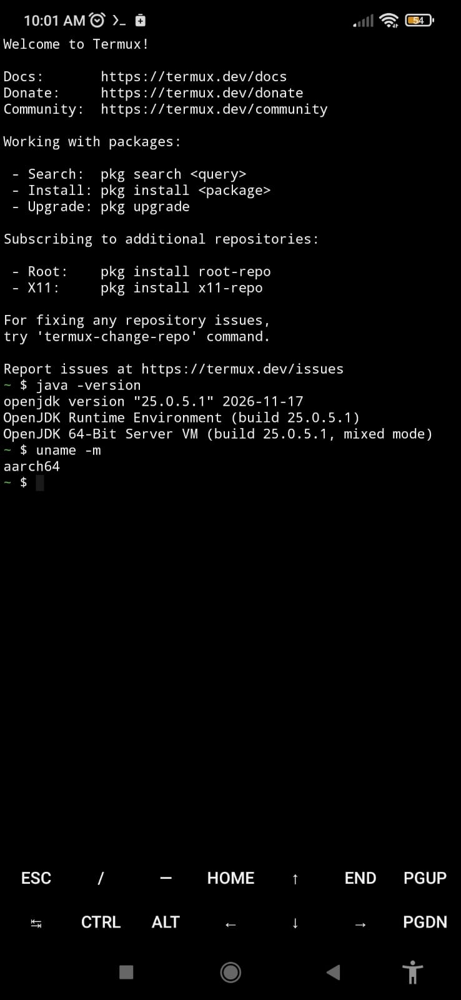
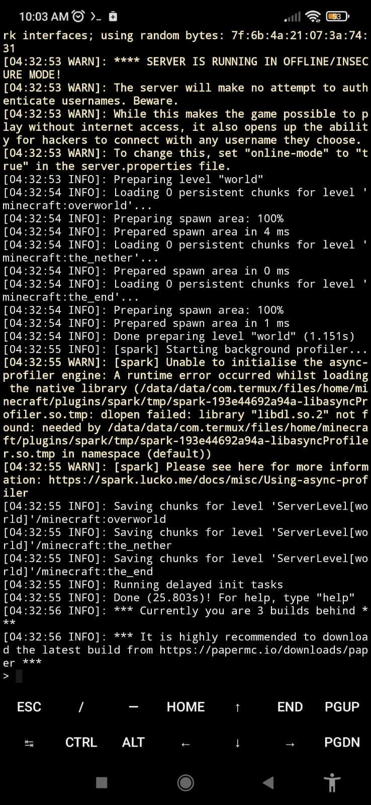
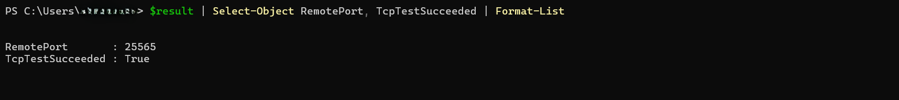

# Android-Homelab 📱

### Turn old Android smartphones into low-cost homelab servers.

Have an unused Android smartphone? This project explores how to repurpose it as a small, practical homelab host using Termux and compatible self-hosted applications.

Android-Homelab is a beginner-friendly, hands-on documentation project. It records the setup, commands, configuration, security considerations and lessons learned while running services on an Android phone.

The goal is to learn Linux fundamentals, networking, server administration, security, backups and automation using hardware that may already be available.

---

## Project goals

- Repurpose unused Android smartphones for useful server experiments.
- Learn Linux command-line fundamentals with Termux.
- Understand IP addresses, ports, TCP and remote connectivity.
- Host more than one type of self-hosted application over time.
- Practise access control, backups and troubleshooting.
- Publish repeatable, beginner-friendly tutorials based on tested work.

## Current applications

| Application | Purpose | Status |
|---|---|---|
| [Minecraft Java server](applications/minecraft-server/README.md) | Host a small multiplayer Minecraft Java server with PaperMC | Implemented and documented |
| File server | Share files over a private network | Planned |
| Web server | Host websites or web applications | Planned |

The Minecraft server is the first implementation. The file and web server entries are planned work, not completed services.

## Initial test device

The first implementation was carried out on a Redmi Note 8 Pro.

| Component | Specification |
|---|---|
| Device | Redmi Note 8 Pro |
| Processor | MediaTek Helio G90T |
| Physical RAM | 6 GB |
| Internal storage | 128 GB |
| Android version | Android 11 |
| Termux architecture reported by uname | aarch64 |
| Java observed in Termux | OpenJDK 25.0.5.1 |

These are the specifications and software versions observed on the test device. They are not minimum requirements or a performance guarantee for other phones.

## Technologies

| Technology | Role |
|---|---|
| Termux | Android terminal and Linux-like user-space environment |
| OpenJDK | Java runtime for PaperMC |
| PaperMC | Minecraft Java server implementation |
| tmux | Manage the server terminal session |
| Tailscale | Private remote network connectivity |
| Termux/Linux utilities | File management, downloads and administration |

## Documentation

### Foundations

1. [Introduction to Android Homelabs](docs/introduction.md)
2. [Hardware Requirements](docs/hardware-requirements.md)
3. [Installing Termux](docs/termux-installation.md)
4. [Linux Command-Line Fundamentals](docs/termux-basics.md)
5. [Networking Fundamentals](docs/networking-basics.md)
6. [System Architecture](docs/architecture.md)

### Operating the homelab

7. [Remote Access with Tailscale](docs/remote-access.md)
8. [Security Best Practices](docs/security.md)
9. [Backups and Recovery](docs/backups-and-recovery.md)
10. [General Troubleshooting](docs/troubleshooting.md)

### Minecraft application guide

- [Minecraft server overview](applications/minecraft-server/README.md)
- [Installation](applications/minecraft-server/installation.md)
- [Configuration](applications/minecraft-server/configuration.md)
- [Troubleshooting](applications/minecraft-server/troubleshooting.md)

## Implementation screenshots

These screenshots document the actual test setup:








The initial PaperMC startup screenshot includes warnings described in the installation guide. It is evidence that the server reached its startup-complete message, not a claim that every warning has been resolved.

## Security notes

The initial Minecraft experiment used offline mode for the launchers used during testing. Offline mode does not reliably authenticate player identities. A whitelist does not solve that identity-verification problem.

Keep that experimental server private and limited to trusted participants. Prefer normal Minecraft account authentication for a server that needs reliable identity verification. Read the [security guide](docs/security.md) before exposing any service to other devices.

Never commit passwords, tokens, private keys, private server backups or personal network details to this public repository.

## Limitations

- Termux provides a Linux-like user-space environment inside Android; it does not replace Android with a conventional Linux server operating system.
- Android background-management policies may stop or restrict long-running processes.
- Sustained workloads can cause thermal throttling.
- Android and other applications share the phone's RAM and CPU.
- Compatibility and performance vary by phone, Android version and application.

This project is intended for learning and small-scale experimentation, not as a guaranteed replacement for production server infrastructure.

## Roadmap

- [x] Create the public repository and add a license.
- [x] Document Android homelab foundations.
- [x] Document the first Minecraft Java server implementation.
- [x] Add implementation screenshots and an architecture diagram.
- [ ] Review and test all tutorials from a clean setup.
- [ ] Add more tested screenshots and command output.
- [ ] Build and document a file server.
- [ ] Build and document a web server.
- [ ] Add reusable server-management and backup scripts.
- [ ] Explore monitoring and performance measurement.

## Contributing

Corrections, suggestions and additional application tutorials are welcome. Please open an issue to discuss a substantial change or submit a pull request with a clear description.

Before submitting documentation changes, run the local checks:

```bash
python scripts/check_docs.py
```

GitHub Actions runs the same check on pushes and pull requests. It checks local Markdown links and fenced code blocks; it does not verify external websites or prove that commands work on a physical Android device.

## License

This project is licensed under the [MIT License](LICENSE).
