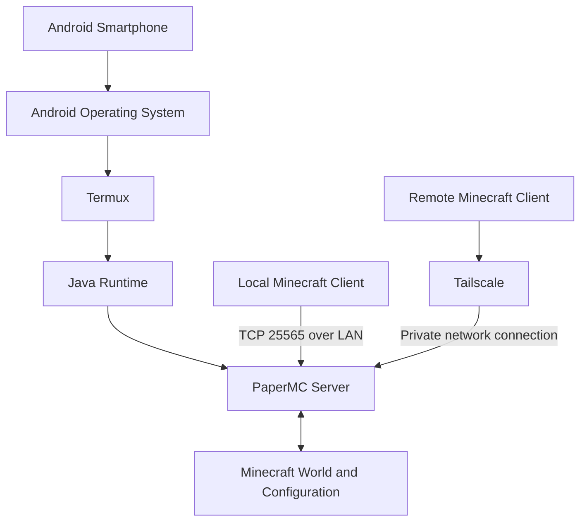
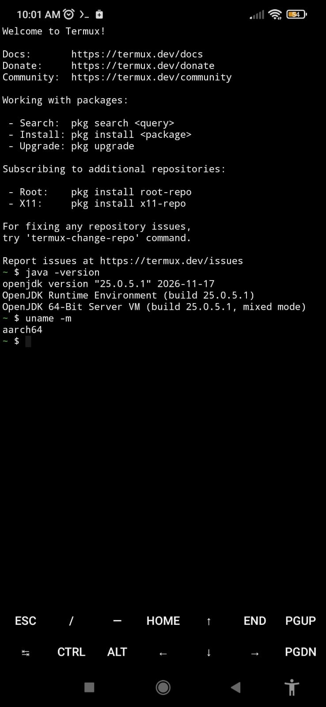
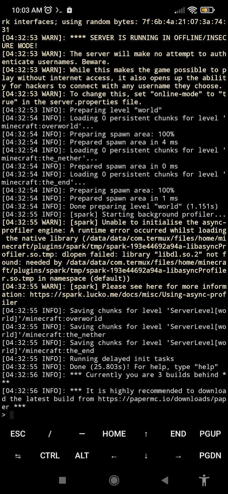
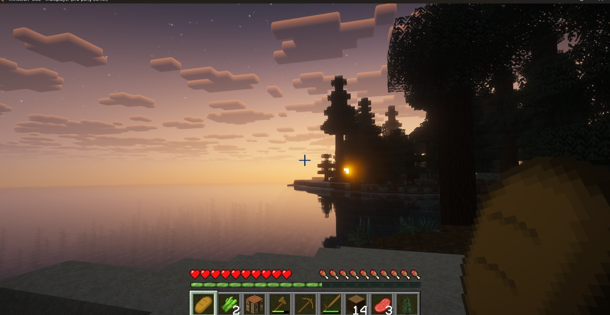

# Minecraft Java Server on Android

## 1. Introduction

This guide documents the first application hosted by Android-Homelab: a Minecraft Java Edition server running on an Android smartphone.

We use Termux to provide a Linux-like user-space environment, Java to run the server application, PaperMC as the Minecraft server software, tmux to manage the terminal session and Tailscale for private remote connectivity.

The initial implementation was tested on a Redmi Note 8 Pro. This is a small-scale learning and experimentation setup, not a claim that every Android device can host a Minecraft server with the same performance.

## 2. What Are We Building?

The Android phone runs PaperMC locally. Minecraft clients connect over the same Wi-Fi network or, when remote access is needed, through Tailscale.

### Architecture



### Components

- **Android:** Provides the phone's hardware, operating system, storage and network interfaces.
- **Termux:** Provides the terminal and Linux-like user-space environment used to install and manage server software.
- **Java:** Runs the Java-based PaperMC application. The required version depends on the Minecraft/Paper release.
- **PaperMC:** Processes player connections, gameplay, world updates and server commands.
- **tmux:** Keeps the server process in a manageable terminal session that can be detached and reattached.
- **Tailscale:** Provides private connectivity for authorized remote devices. It does not replace application-level authentication.

## 3. Test Device

The initial implementation used:

| Component | Specification |
|---|---|
| Device | Redmi Note 8 Pro |
| Processor | MediaTek Helio G90T |
| Physical RAM | 6 GB |
| Internal storage | 128 GB |
| Operating system | Android 11 |
| Termux architecture reported by `uname -m` | `aarch64` |
| Java observed during testing | OpenJDK 25.0.5.1 |

These values describe the test device and environment, not minimum requirements for every setup.

## 4. Software and Technologies

| Software | Purpose |
|---|---|
| Termux | Command-line environment on Android |
| OpenJDK | Java runtime |
| PaperMC | Minecraft Java server |
| tmux | Terminal session management |
| Tailscale | Private remote connectivity |
| curl and jq | Retrieve and process PaperMC download metadata |

Official resources:

- [Termux](https://github.com/termux/termux-app)
- [OpenJDK](https://openjdk.org/)
- [PaperMC](https://papermc.io/)
- [tmux](https://github.com/tmux/tmux)
- [Tailscale](https://tailscale.com/)

## 5. Implemented Capabilities

The initial implementation and its documentation cover:

- Running a Minecraft Java server on Android using PaperMC.
- Managing the process through Termux and tmux.
- Editing server configuration and managing the whitelist.
- Connecting through the local network.
- Connecting remotely through Tailscale.
- Creating manual server backups.
- Troubleshooting startup and connectivity problems.

These capabilities describe the documented implementation. Additional automation and monitoring remain future work.

## 6. Local and Remote Connectivity

### Local network

When the Android phone and client are on the same local network, the client can use the phone's local IP address and Minecraft's default Java server port:

```text
ANDROID_LOCAL_IP:25565
```

The address is a placeholder. Use the phone's current local IP address.

### Remote access

For remote access, authorized client devices connect through Tailscale and use the Android phone's Tailscale IP address:

```text
ANDROID_TAILSCALE_IP:25565
```

Do not publish actual private IP addresses or device details in this public repository.

See [Remote Access Using Tailscale](../../docs/remote-access.md).

## 7. Authentication and Security

The initial experiment used:

```properties
online-mode=false
```

This disables normal Minecraft account authentication. The whitelist restricts usernames but does not reliably verify the identity of a player in offline mode; someone may impersonate an allowed username.

Keep this experimental setup private and limited to trusted participants. Do not expose it directly to the public internet. For reliable account identity verification, prefer appropriately authenticated Minecraft accounts and `online-mode=true`.

Tailscale protects the network path and controls network access according to its sharing and access policies, but it does not replace Minecraft account authentication.

See the [Android Homelab Security Guide](../../docs/security.md).

## 8. Tutorials

| Tutorial | What it covers |
|---|---|
| [Installation](installation.md) | Prepare Termux, install Java, download PaperMC, accept the EULA and start the server |
| [Configuration](configuration.md) | Configure server properties, whitelist, gameplay and access settings |
| [Troubleshooting](troubleshooting.md) | Diagnose Java, PaperMC, tmux, Tailscale, connection and performance issues |

## 9. Screenshots

The following screenshots document stages of the initial implementation:







Remote TCP connectivity evidence is included in the [Tailscale remote-access guide](../../docs/remote-access.md).

## 10. Limitations

An Android smartphone is not equivalent to dedicated server hardware.

- Android may restrict background applications.
- Sustained CPU workloads may cause thermal throttling.
- Android and other applications share the phone's RAM and CPU.
- Storage capacity limits world size and backup space.
- Wi-Fi and internet quality affect remote access.
- Performance depends on player activity, world complexity, plugins and device condition.

This implementation is intended for learning and small-scale experimentation rather than production workloads.

## 11. Conclusion

This application demonstrates how an Android smartphone can host a Minecraft Java Edition server using Termux and PaperMC.

It also provides practical experience with Linux-like command-line tools, Java, process management, networking, remote access, application security and backups.

The implementation serves as the first example of the broader Android-Homelab project.

## 12. References

- [PaperMC Documentation](https://docs.papermc.io/)
- [PaperMC Downloads Service](https://docs.papermc.io/misc/downloads-service/)
- [Termux Official Repository](https://github.com/termux/termux-app)
- [OpenJDK](https://openjdk.org/)
- [tmux Documentation](https://github.com/tmux/tmux)
- [Tailscale Documentation](https://tailscale.com/docs/)
