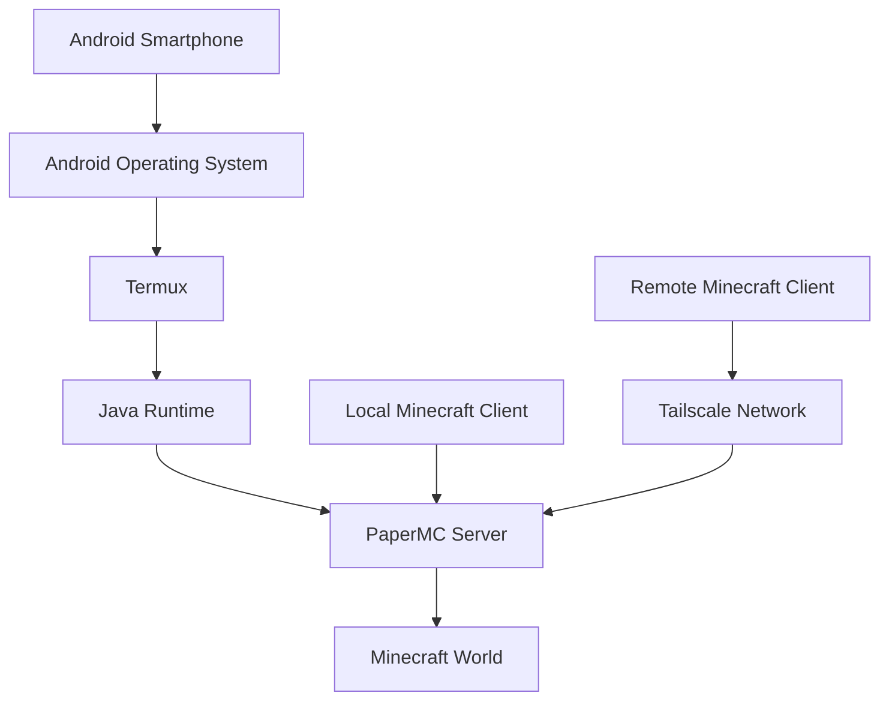

# Minecraft Java Server on Android

## 1. Introduction

This guide documents how to repurpose an Android smartphone into a Minecraft Java Edition multiplayer server.

Instead of purchasing dedicated server hardware, we use an unused Android smartphone to host a Minecraft server using Termux and PaperMC.

The objective is to create a small, private multiplayer environment that can be accessed by players connected to the same local network or through a private remote-access network.

This implementation is also an opportunity to learn practical concepts involving:

- Linux-like command-line environments.
- Java application runtimes.
- Server configuration.
- Network communication.
- Remote access.
- Process management.
- Data backups.
- Server troubleshooting.

This is the first fully documented application in the Android-Homelab project.

---

## 2. What Are We Building?

We are hosting a Minecraft Java Edition server directly on an Android smartphone.

The Android device runs Termux, which provides the environment required to install Java and execute PaperMC.

PaperMC manages the Minecraft server and allows players to connect using compatible Minecraft Java Edition clients.

For remote connectivity, we use Tailscale so that authorized players can connect even when they are using different internet connections.

### Architecture



### How the components work together

**Android Smartphone**

Provides the hardware resources, including the processor, RAM, storage and network connectivity.

**Termux**

Provides the terminal and Linux-like user-space environment in which we install and manage the server software.

**Java Runtime**

Executes the Java-based PaperMC server application.

**PaperMC**

Runs the Minecraft Java Edition server and processes player connections, world updates and game logic.

**Tailscale**

Provides private connectivity between authorized devices so that players can access the server remotely.

---

## 3. Hardware Used

The initial implementation was tested on the following device:

| Component | Specification |
|---|---|
| Device | Redmi Note 8 Pro |
| Processor | MediaTek Helio G90T |
| Physical RAM | 6 GB |
| Internal Storage | 128 GB |
| Operating System | Android 11 |

These specifications describe the device used in this implementation.

They are not guaranteed minimum requirements for every Minecraft server setup.

Performance depends on factors such as world size, player count, plugins, render and simulation settings, available memory and sustained processor performance.

---

## 4. Software and Technologies

| Software | Purpose |
|---|---|
| Termux | Provides the command-line environment |
| Java | Runs the Minecraft server |
| PaperMC | Minecraft Java Edition server implementation |
| tmux | Keeps the server session manageable |
| Tailscale | Provides private remote connectivity |
| Minecraft Java Edition | Client application used by players |

Official websites:

- [Termux](https://github.com/termux/termux-app)
- [Java](https://openjdk.org/)
- [PaperMC](https://papermc.io/)
- [tmux](https://github.com/tmux/tmux)
- [Tailscale](https://tailscale.com/)

Always check the Java requirements of the selected PaperMC and Minecraft versions before installation.

---

## 5. Features of This Implementation

The initial server setup includes:

- Minecraft Java Edition multiplayer hosting.
- PaperMC server software.
- Server management through Termux.
- Persistent terminal sessions using tmux.
- Player access control through the Minecraft whitelist.
- Local network connectivity.
- Remote connectivity using Tailscale.
- Manual world backups.
- Basic server troubleshooting.

Additional features may be added as the project develops.

---

## 6. Local and Remote Connectivity

The Minecraft server can be accessed in two different ways.

### Local Network Access

When the Android smartphone and Minecraft client are connected to the same local network, the client can connect using the phone's local IP address and the server port.

The default Minecraft Java server port is:

```text
25565
```

Example connection address:

```text
192.168.1.15:25565
```

This is an illustrative address, not the actual address of the test device.

### Remote Access Using Tailscale

When players are connected from different locations, we use Tailscale.

Each authorized device connects to the private network.

The Minecraft client then uses the Android phone's Tailscale IP address and the Minecraft server port.

Example:

```text
YOUR_TAILSCALE_IP:25565
```

Replace the placeholder with the actual device address.

Do not publish real Tailscale IP addresses or private network details in this public repository.

---

## 7. Server Configuration and Security

The initial implementation was configured for a small private multiplayer environment.

The server uses a whitelist to restrict which Minecraft usernames are permitted to join.

One important detail is the authentication configuration.

The initial experimental setup used:

```properties
online-mode=false
```

This disables normal Minecraft account authentication by the server.

It was used for compatibility with the offline-profile launchers used during the initial experiment.

**Security warning:** Offline mode does not reliably verify player identities. A whitelist in offline mode does not prevent someone from impersonating an allowed username.

For this reason:

- Keep the experimental server restricted to trusted participants.
- Do not expose it directly to the public internet.
- Do not grant operator privileges unnecessarily.
- Prefer normal authenticated Minecraft accounts and `online-mode=true` for a server requiring reliable account verification.

Tailscale protects network communication, but it does not replace Minecraft account authentication.

See the general [Security Guide](../../docs/security.md).

---

## 8. Documentation Roadmap

The Minecraft server implementation will be documented through the following tutorials.

| Tutorial | Description | Status |
|---|---|---|
| Server Overview | Understand the architecture and technologies | Current page |
| Installation | Install Java and PaperMC | Coming soon |
| Configuration | Configure the Minecraft server | Coming soon |
| Troubleshooting | Diagnose server and connectivity problems | Coming soon |

The guides will be developed using the actual Android server setup and verified commands wherever possible.

---

## 9. Limitations

An Android smartphone is not equivalent to dedicated server hardware.

Some limitations include:

- Android may restrict background applications.
- Sustained CPU workloads may cause thermal throttling.
- Available RAM is shared with Android and other applications.
- Storage capacity may limit world size and backups.
- Wi-Fi and internet connectivity affect remote access.
- Performance depends on the number of players and server workload.

This implementation is intended primarily for learning and small-scale experimentation.

It should not be treated as a guaranteed replacement for production server infrastructure.

---

## 10. Conclusion

This project demonstrates how an unused Android smartphone can be repurposed into a Minecraft Java Edition server using Termux and PaperMC.

By combining Android hardware, Java, server software and private networking, we can create a small multiplayer environment without purchasing dedicated server hardware.

More importantly, the implementation provides practical experience with Linux-like environments, server administration, network communication, security and data management.

The next tutorial will explain the complete installation process, starting with preparing Termux and installing a compatible Java runtime.

---

## 11. References

- [PaperMC Documentation](https://docs.papermc.io/)
- [Termux Official Repository](https://github.com/termux/termux-app)
- [OpenJDK](https://openjdk.org/)
- [tmux Documentation](https://github.com/tmux/tmux)
- [Tailscale Documentation](https://tailscale.com/docs/)
