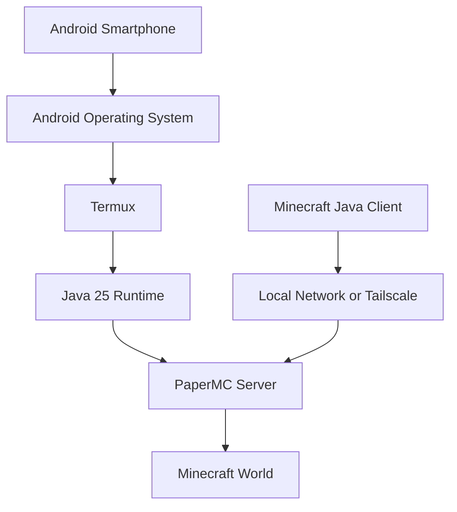
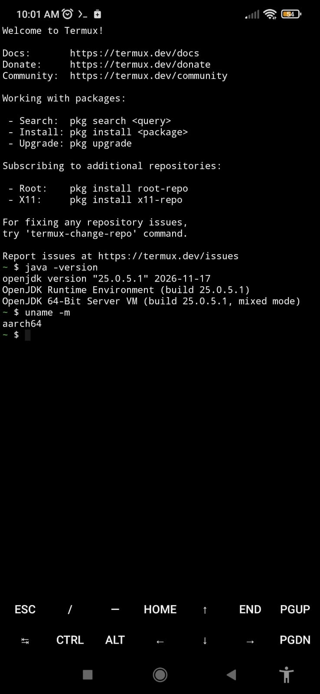

# Installing a Minecraft Java Server on Android Using Termux and PaperMC

## 1. Introduction

This tutorial explains how to host a Minecraft Java Edition server directly on an Android smartphone.

We will use Termux to create a Linux-like command-line environment, install Java, download PaperMC and configure the server.

The server will run on the Android smartphone without requiring a separate computer to host it.

This guide follows the initial implementation of the Android-Homelab project using a Redmi Note 8 Pro.

By the end of this tutorial, we will have a working Minecraft Java server that can accept connections from compatible Minecraft clients on the local network.

Remote access through Tailscale will be covered separately.

## 2. Understanding the Architecture

Before installation, let's understand how the different components work together.



### Component descriptions

**Android:** Provides the hardware and operating system.

**Termux:** Provides the terminal and command-line environment.

**Java:** Executes the PaperMC server application.

**PaperMC:** Handles Minecraft gameplay, player connections and world processing.

**tmux:** Allows us to keep the server process inside a manageable terminal session.

**Minecraft Client:** The application players use to connect to the server.

## 3. Requirements

### Hardware requirements

For this implementation, we use:

| Component | Specification |
|---|---|
| Device | Redmi Note 8 Pro |
| Processor | MediaTek Helio G90T |
| RAM | 6 GB physical RAM |
| Storage | 128 GB |
| Operating System | Android 11 |
| Connectivity | Wi-Fi and internet access |

These are the specifications of our test device, not guaranteed minimum requirements for all Android Minecraft servers.

Performance depends on the number of players, world size, plugins, device temperature and available resources.

### Software requirements

We need:

- Termux.
- Java 25.
- PaperMC for Minecraft 26.3.
- curl for downloading files.
- jq for processing JSON responses.
- tmux for managing the server session.

We will install the required command-line tools using Termux's package manager.

## 4. Preparing Termux

Open Termux on your Android smartphone.

Before installing server software, update the package information.

**Execute this command in the Termux shell:**

```bash
pkg update
```

After the update finishes, upgrade installed packages:

```bash
pkg upgrade
```

Termux may ask for confirmation. Review the prompt and enter `y` when ready.

This helps ensure that the installed packages are up to date.

## 5. Checking the Processor Architecture

Different Android smartphones use different processor architectures.

Before installing software, it is useful to identify the architecture reported by Termux.

Execute:

```bash
uname -m
```

Common results include:

| Output | Architecture |
|---|---|
| `aarch64` | 64-bit ARM |
| `armv7l` | 32-bit ARM |
| `x86_64` | 64-bit x86 |
| `i686` | 32-bit x86 |

The Redmi Note 8 Pro uses a 64-bit ARM-based platform.

The command helps verify the architecture of the running environment, which is important when checking software compatibility.

## 6. Installing Java 25

PaperMC is a Java-based server application.

This means we need a compatible Java runtime before attempting to start the server.

For Minecraft 26.1 and later, PaperMC requires Java 25.

### Step 1: Search for the Java package

Execute:

```bash
pkg search openjdk
```

This searches the configured Termux repositories for OpenJDK packages.

### Step 2: Install Java 25

Execute:

```bash
pkg install openjdk-25
```

Wait for the installation to finish.

If the package is unavailable, check the configured Termux repositories and the official Termux package documentation rather than downloading an unofficial Java APK.


### Step 3: Verify Java installation

Execute:

```bash
java -version
```

The output should identify Java version 25.

For example, it may contain:

```text
openjdk version "25..."
```

The exact patch version can change as updates are released.



### Why do we need Java?

PaperMC is distributed as an executable Java archive.

When we execute:

```bash
java -jar paper.jar
```

Java loads the JAR file and runs the server application.

Without a compatible Java runtime, PaperMC cannot start.

Official references:

- [PaperMC Getting Started](https://docs.papermc.io/paper/getting-started/)
- [OpenJDK](https://openjdk.org/)
- [Termux Packages](https://github.com/termux/termux-packages)

## 7. Installing the Required Utilities

We need three additional tools:

- curl: Downloads files from the internet.
- jq: Processes JSON data.
- tmux: Manages terminal sessions.

Execute:

```bash
pkg install curl jq tmux nano
```

Let's understand their purposes.

| Package | Purpose |
|---|---|
| curl | Communicates with download services |
| jq | Extracts information from JSON responses |
| tmux | Keeps server sessions manageable |
| nano | Edits configuration files |

Check that curl is installed:

```bash
curl --version
```

Check jq:

```bash
jq --version
```

Check tmux:

```bash
tmux -V
```

## 8. Creating the Minecraft Server Directory

It is good practice to keep application files organized.

We will create a dedicated directory for Minecraft.

### Step 1: Return to the Termux home directory

Execute:

```bash
cd ~
```

The `~` symbol represents the Termux user's home directory.

### Step 2: Create the Minecraft directory

Execute:

```bash
mkdir -p ~/minecraft
```

This creates the directory if it does not already exist.

### Step 3: Enter the directory

Execute:

```bash
cd ~/minecraft
```

### Step 4: Verify the current location

Execute:

```bash
pwd
```

The path should end with:

```text
/minecraft
```

Our server software and generated world files will be stored here.

The directory will eventually contain:

```text
minecraft/
├── paper.jar
├── eula.txt
├── server.properties
├── world/
├── world_nether/
├── world_the_end/
├── logs/
└── plugins/
```

The actual directories are generated as the server runs and depend on its configuration.

## 9. Downloading PaperMC

PaperMC is a Minecraft Java Edition server implementation.

It is based on the Bukkit/Spigot ecosystem and provides performance improvements and additional server functionality.

Official website:

https://papermc.io/

### Understanding the Download API

PaperMC provides an official downloads service that allows software to retrieve build information and download stable server builds.

We will use its version 3 API.

The download process involves:

1. Requesting builds for a Minecraft version.
2. Finding a stable build.
3. Retrieving its official download URL.
4. Downloading the server JAR.

We will use Minecraft version `26.3`, matching the initial implementation of this project.

### Step 1: Set the project and version

Execute:

```bash
PROJECT="paper"
```

Then:

```bash
MC_VERSION="26.3"
```

These variables identify the PaperMC project and Minecraft version.

### Step 2: Set a descriptive User-Agent

PaperMC's download service requires requests to include a descriptive User-Agent with a contact URL or email address.

Execute:

```bash
USER_AGENT="Android-Homelab/1.0 (https://github.com/TarunES98800/Android-Homelab)"
```

This identifies our tutorial project to the download service.

### Step 3: Retrieve the available builds

Execute:

```bash
BUILDS_JSON=$(curl -fsSL -H "User-Agent: $USER_AGENT" "https://fill.papermc.io/v3/projects/$PROJECT/versions/$MC_VERSION/builds")
```

This requests build information from the official PaperMC download service.

The response contains JSON data describing available builds.

### Step 4: Extract the stable download URL

Execute:

```bash
PAPER_URL=$(printf '%s\n' "$BUILDS_JSON" | jq -r 'first(.[] | select(.channel == "STABLE") | .downloads."server:default".url) // empty')
```

Let's understand the command.

- `printf` supplies the JSON response.
- `jq` processes the JSON.
- `select(.channel == "STABLE")` selects stable builds.
- `.downloads."server:default".url` extracts the server download URL.
- `first(...)` selects the first matching stable build.
- `// empty` returns an empty result if no suitable build is found.

Check the result:

```bash
echo "$PAPER_URL"
```

A valid result should be a PaperMC download URL.

If the output is empty, check whether a stable build is available for the chosen Minecraft version.

### Step 5: Download PaperMC

First, make sure you are still inside:

```text
~/minecraft
```

Then execute:

```bash
curl -fL "$PAPER_URL" -o paper.jar
```

The options mean:

| Option | Purpose |
|---|---|
| `-f` | Treat HTTP error responses as failures |
| `-L` | Follow HTTP redirects |
| `-o` | Save the download using a specified filename |

The downloaded file will be saved as:

```text
paper.jar
```

### Step 6: Verify the download

Execute:

```bash
ls -lh paper.jar
```

This displays the downloaded file and its size.

If the download did not complete successfully, do not attempt to start the server. Recheck the API response and download command.

PaperMC documentation:

https://docs.papermc.io/misc/downloads-service/

## 10. First Server Startup

Now that Java and PaperMC are installed, we can attempt to start the server.

Make sure the current directory is:

```text
~/minecraft
```

Execute:

```bash
java -Xms512M -Xmx2G -jar paper.jar --nogui
```

### Understanding the command

| Part | Meaning |
|---|---|
| `java` | Starts the Java runtime |
| `-Xms512M` | Sets the initial Java heap size to 512 MB |
| `-Xmx2G` | Sets the maximum Java heap size to 2 GB |
| `-jar` | Executes a Java archive |
| `paper.jar` | The downloaded PaperMC server |
| `--nogui` | Runs without Minecraft's graphical server interface |

These memory values are the settings used in our initial implementation.

They are not universal recommendations. Android and other running applications also need RAM, so adjust memory settings according to actual device usage.

### What happens during the first startup?

PaperMC initializes its server environment and generates configuration files.

On a fresh installation, it will normally stop because the Minecraft EULA has not yet been accepted.

This is expected behaviour.

## 11. Understanding and Accepting the Minecraft EULA

Minecraft server software requires users to accept its End User License Agreement before running the server.

During the first startup, PaperMC creates a file named:

```text
eula.txt
```

### Step 1: Open the EULA file

Execute:

```bash
nano eula.txt
```

### Step 2: Review the agreement

Read the EULA and review the official terms:

https://aka.ms/MinecraftEULA

Do not accept the agreement automatically without reading it.

### Step 3: Accept only if you agree

If you agree to the terms, change:

```properties
eula=false
```

to:

```properties
eula=true
```

### Step 4: Save the file

In Nano:

1. Press `Ctrl + O`.
2. Press `Enter` to confirm the filename.
3. Press `Ctrl + X` to exit.

### Why is this required?

The server checks the EULA setting during startup.

Without an accepted EULA, it will not proceed with normal operation.

## 12. Starting the Server Again

After accepting the EULA, we can start PaperMC again.

First, verify the directory:

```bash
cd ~/minecraft
```

Then execute:

```bash
java -Xms512M -Xmx2G -jar paper.jar --nogui
```

PaperMC will now continue initialization.

It may generate additional files and directories, including:

- `server.properties`
- `logs/`
- World directories
- Other server configuration files

Wait until the server finishes loading.

A successful startup normally displays a message similar to:

```text
Done (...)! For help, type "help"
```

The exact timing and additional console output will vary.

At this point, PaperMC is running in the foreground of the Termux shell.

Do not close Termux or terminate Java while the server is running.

In the next section, we will put the server inside a tmux session.

## 13. Running PaperMC Inside tmux

When a server runs directly in the terminal, closing the terminal session can terminate the server process.

To manage the server more conveniently, we use tmux.

tmux stands for **Terminal Multiplexer**.

It allows us to create persistent terminal sessions and detach from them without intentionally stopping the processes running inside them.

### Step 1: Stop the currently running server

In the PaperMC console, enter:

```text
stop
```

Wait for the server to finish saving and shutting down.

This is a Minecraft server command, not a Termux shell command.

### Step 2: Create a tmux session

Back in the normal Termux shell, execute:

```bash
tmux new -s minecraft
```

This creates a new tmux session named `minecraft`.

### Step 3: Start PaperMC inside tmux

Inside the new tmux session, execute:

```bash
cd ~/minecraft
```

Then:

```bash
java -Xms512M -Xmx2G -jar paper.jar --nogui
```

Wait for PaperMC to finish loading.

The Minecraft server is now running inside the tmux session.

### Step 4: Detach from tmux

To leave the session without stopping the server:

1. Press `Ctrl + B`.
2. Release both keys.
3. Press `D`.

You should return to the normal Termux shell.

The server should continue running inside tmux.

### Step 5: Verify the session

Execute:

```bash
tmux ls
```

You should see a session named:

```text
minecraft
```

### Step 6: Reattach to the session

Whenever you need to access the Minecraft server console again, execute:

```bash
tmux attach -t minecraft
```

This returns you to the running server session.

### Important distinction

Commands entered in different environments have different purposes.

| Command | Where to Execute |
|---|---|
| `cd ~/minecraft` | Termux shell |
| `tmux new -s minecraft` | Termux shell |
| `tmux ls` | Termux shell |
| `java -jar paper.jar --nogui` | Termux shell, inside the tmux session |
| `stop` | Minecraft server console |
| `list` | Minecraft server console |
| `whitelist add PlayerName` | Minecraft server console |

Do not enter normal Linux commands into the Minecraft server console.

## 14. Verifying the Server Files

Once the server has started successfully, open a separate Termux session or detach from tmux.

Execute:

```bash
cd ~/minecraft
```

Then:

```bash
ls -lah
```

The directory should contain the PaperMC JAR, configuration files, logs and generated world directories.

You can also check the server directory size:

```bash
du -sh ~/minecraft
```

The actual size depends on the world and the generated server data.

## 15. Testing the Initial Server

The next step is confirming that another Minecraft client can reach the server.

For the local network:

1. Connect the Android phone and client computer to the same Wi-Fi network.
2. Find the Android phone's local IPv4 address in Android Wi-Fi settings.
3. Confirm that PaperMC is running.
4. Open Minecraft Java Edition on the client.
5. Select Multiplayer.
6. Add a server using the Android phone's local IP and port.

The default Minecraft Java server address structure is:

```text
ANDROID_LOCAL_IP:25565
```

For example:

```text
192.168.1.15:25565
```

This is an illustrative address.

The client must use a compatible Minecraft version.

If the connection fails, first verify the server and network before changing authentication or other unrelated settings.

See:

[Networking Fundamentals](../../docs/networking-basics.md)

## 16. Common Installation Problems

### Java command not found

Check:

```bash
java -version
```

Install a compatible runtime from the configured Termux repositories.

For Minecraft 26.3, Java 25 is required.

### Unable to access paper.jar

Check the current directory:

```bash
pwd
```

List the files:

```bash
ls -lh
```

Verify that the downloaded file is actually named `paper.jar`.

### PaperMC exits because the EULA has not been accepted

Read the agreement and, only if you agree, set:

```properties
eula=true
```

inside `eula.txt`.

### Port already in use

Check for existing tmux sessions:

```bash
tmux ls
```

Check running Java processes:

```bash
pgrep -af java
```

Avoid starting multiple server instances on the same port.

### Server stops unexpectedly

Inspect recent logs:

```bash
tail -n 100 ~/minecraft/logs/latest.log
```

Also inspect Android battery restrictions, memory usage and device temperature.

See:

[Android Homelab Troubleshooting](../../docs/troubleshooting.md)

## 17. Security Considerations

Before allowing other users to connect:

- Enable the Minecraft whitelist where appropriate.
- Restrict remote access to trusted participants.
- Keep the server software updated.
- Avoid unnecessary public port forwarding.
- Back up the Minecraft world.
- Protect server configuration files.
- Restrict operator privileges.

Our initial experimental configuration used:

```properties
online-mode=false
```

This disables the server's normal Minecraft account authentication.

The whitelist in offline mode does not reliably verify player identities.

Do not publicly expose this experimental server. Prefer normal authenticated accounts and `online-mode=true` when reliable Minecraft account authentication is required.

See:

[Security Best Practices](../../docs/security.md)

## 18. Conclusion

In this tutorial, we installed the software required to run a Minecraft Java server on an Android smartphone.

We completed the following tasks:

1. Prepared the Termux environment.
2. Checked the processor architecture.
3. Installed Java 25.
4. Installed curl, jq, tmux and Nano.
5. Created the Minecraft server directory.
6. Downloaded a stable PaperMC build.
7. Performed the first server startup.
8. Reviewed and accepted the Minecraft EULA.
9. Started PaperMC inside tmux.
10. Verified the server files and session.

The Android smartphone is now capable of hosting our Minecraft Java server.

The next tutorial will cover server configuration, including server properties, player limits, whitelist management, view distance and other settings.

## 19. References

- [PaperMC Getting Started](https://docs.papermc.io/paper/getting-started/)
- [PaperMC Downloads Service](https://docs.papermc.io/misc/downloads-service/)
- [PaperMC Downloads](https://papermc.io/downloads/paper)
- [Termux Official Repository](https://github.com/termux/termux-app)
- [Termux Packages](https://github.com/termux/termux-packages)
- [tmux GitHub Repository](https://github.com/tmux/tmux)
- [Minecraft End User License Agreement](https://www.minecraft.net/eula)
