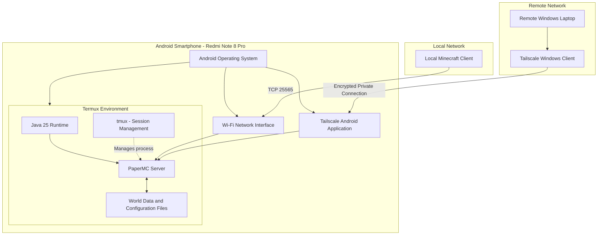
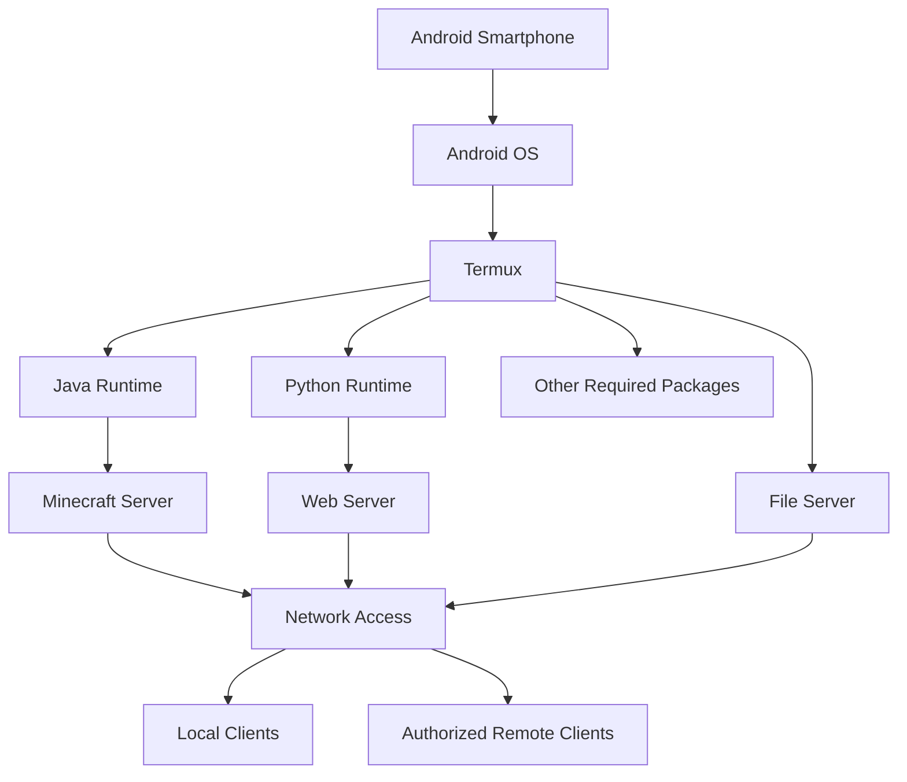

# Android Homelab Architecture

## 1. Overview

This document explains the architecture of Android-Homelab and how its different components work together.

The project uses an Android smartphone as a host for compatible self-hosted applications.

Instead of installing a conventional Linux server operating system, we use Termux to provide a Linux-like user-space environment within Android.

The initial implementation uses a Redmi Note 8 Pro to host a Minecraft Java server using PaperMC.

The architecture is designed to support additional server applications in the future.

## 2. System Architecture

The following diagram illustrates the overall architecture of the Android homelab.



## 3. Understanding the Components

### Android Operating System

Android manages the smartphone's hardware, applications, memory, networking and permissions.

It provides the environment in which Termux and the Tailscale Android application operate.

### Termux

Termux provides a terminal emulator and Linux-like user-space environment.

We use it to install software packages, manage files, execute scripts and run compatible applications.

### Java Runtime

Java provides the runtime environment required by Java-based applications.

Our initial Minecraft implementation uses OpenJDK 25.

The required Java version depends on the Minecraft and server software versions.

### PaperMC

PaperMC is the Minecraft Java server implementation used in our initial homelab.

It handles:

- Player connections.
- Game logic.
- World processing.
- Server commands.
- Plugin management.

The default Minecraft Java server port is TCP 25565.

### tmux

tmux is a terminal multiplexer that allows us to manage the server process inside a persistent terminal session.

It lets us detach from the terminal without intentionally terminating the server.

### Server Data

The server stores world data, configurations, logs and other application files inside its Termux directory.

For our implementation:

```text
~/minecraft/
```

### Tailscale

Tailscale provides private network connectivity between authorized devices.

It runs as an Android application on the host and as a client on remote devices.

It allows remote clients to reach the Minecraft server through an encrypted private network connection.

Tailscale provides network connectivity; Minecraft still handles its own player authentication.

## 4. How Local Network Connections Work

When a Minecraft client is connected to the same local network as the Android server:

1. The player enters the Android phone's local IP address.
2. The Minecraft client attempts a TCP connection to port 25565.
3. Android receives the network traffic through its Wi-Fi interface.
4. PaperMC receives the connection.
5. The server processes the player's connection and sends game data.

Example address:

```text
ANDROID_LOCAL_IP:25565
```

The IP address is a placeholder and should be replaced with the phone's actual local address.

## 5. How Remote Connections Work

When a player connects from another location:

1. The remote computer connects to Tailscale.
2. The Android smartphone also connects to Tailscale.
3. Tailscale establishes private encrypted network connectivity.
4. The remote Minecraft client sends a connection request to the Android device's Tailscale IP and TCP port 25565.
5. The Android device delivers the connection to PaperMC.
6. PaperMC processes the player's connection.

Example address:

```text
YOUR_TAILSCALE_IP:25565
```

Tailscale does not automatically start the Minecraft server. PaperMC must already be running.

## 6. Future Multi-Application Architecture

The long-term goal is to host multiple compatible applications on the same Android smartphone.

The architecture may eventually look like this:



Each application will have its own installation, configuration, security and backup requirements.

Running multiple services simultaneously will depend on available CPU resources, physical RAM, storage, temperature and Android background-management behaviour.

## 7. Security Considerations

- Keep remote access restricted to authorized devices.
- Avoid unnecessary public port forwarding.
- Protect application credentials.
- Do not publish private network addresses or authentication tokens.
- Use application-level authentication wherever supported.
- Maintain backups of important server data.
- Understand Android and Termux permission restrictions.

## 8. Conclusion

Android-Homelab uses an existing Android smartphone as a lightweight platform for experimenting with self-hosted applications.

By combining Android, Termux, Java, PaperMC and Tailscale, we can create a practical environment for learning Linux, networking and server administration.

The architecture is intentionally modular so that additional applications can be introduced and managed independently.

As the project grows, this document will be updated to reflect new services and architectural changes.

## 9. References

- [Termux Official Repository](https://github.com/termux/termux-app)
- [PaperMC Documentation](https://docs.papermc.io/)
- [OpenJDK](https://openjdk.org/)
- [tmux Documentation](https://github.com/tmux/tmux)
- [Tailscale Documentation](https://tailscale.com/docs/)
