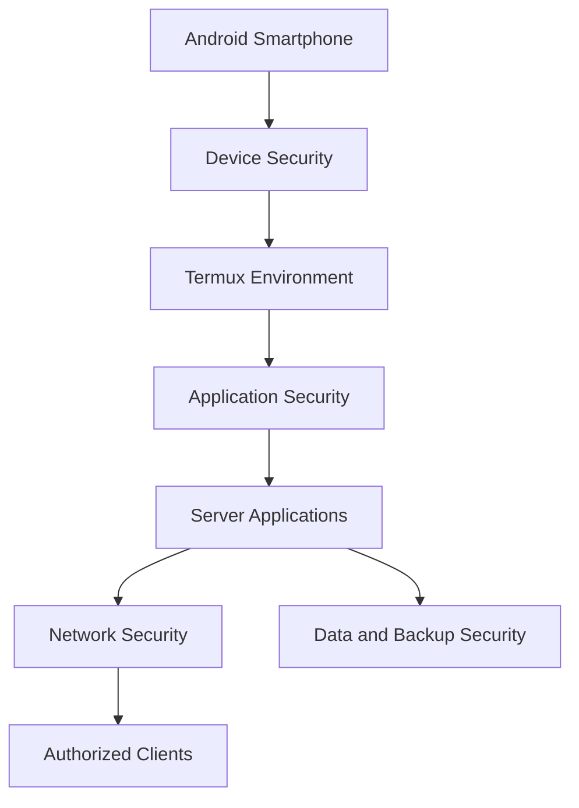

# Security Best Practices for an Android Homelab

## 1. Introduction

When converting an Android smartphone into a homelab server, security should be considered from the beginning.

A server may store files, host applications, manage network connections and allow remote users to access its services.

If it is configured incorrectly, unauthorized users may access sensitive information, misuse applications or disrupt the services being hosted.

Security is therefore not just about protecting the phone. It also involves protecting applications, network connections, credentials and stored data.

This chapter explains practical security measures for an Android-based homelab.

## 2. Understanding the Security Layers

An Android homelab has several components that require protection.

These can be divided into different security layers.

| Security Layer | What Needs Protection |
|---|---|
| Device Security | Android operating system and physical device |
| Application Security | Termux and installed applications |
| File Security | Server files, configurations and backups |
| Network Security | Local and remote network connections |
| Authentication | User identities and access permissions |
| Data Security | Private information and stored data |

Security should be considered at every layer rather than relying on a single security tool.

### Example Architecture



## 3. Securing the Android Device

The Android smartphone is the foundation of our homelab.

If someone gains unauthorized access to the device, they may also gain access to the applications and files stored on it.

Therefore, the first step is securing Android itself.

### 3.1 Use a Screen Lock

Enable a secure screen lock on the smartphone.

Android generally supports options such as:

- PIN.
- Password.
- Pattern.
- Fingerprint authentication, when supported.

A strong PIN or password helps prevent unauthorized physical access.

Avoid using easily guessed combinations such as birthdays or repeated numbers.

### 3.2 Keep Android Updated

Operating system updates may include:

- Security fixes.
- Vulnerability patches.
- Compatibility improvements.
- Stability improvements.

Check Android's system update settings regularly.

Some older smartphones no longer receive security updates. When using such devices as experimental servers, avoid storing sensitive personal information and restrict network access.

The Redmi Note 8 Pro used in the initial implementation runs Android 11. Its current security patch status should be checked on the actual device rather than assumed from the Android version alone.

### 3.3 Review Application Permissions

Android applications request permissions to access particular device features or resources.

Examples include:

- Camera.
- Microphone.
- Location.
- Files and media.
- Notifications.

Only grant permissions that are necessary for the application's functionality.

For example, Termux may request shared storage access when the `termux-setup-storage` command is executed.

Grant this permission only when you need Termux to interact with shared Android storage.

### 3.4 Install Applications from Trusted Sources

Download applications from their official distribution sources.

For this project:

- Termux: Official F-Droid distribution or official Termux GitHub releases.
- Tailscale: Official Google Play distribution or official Tailscale download page.

Avoid downloading APK files from unknown websites.

Also, do not mix Termux installations from different distribution sources because their application signing keys may differ.

## 4. Securing the Termux Environment

Termux provides a Linux-like user-space environment inside Android.

It is important to understand that Termux normally runs under Android's application security model.

It does not automatically provide unrestricted root access to the Android operating system.

### 4.1 Avoid Unnecessary Root Access

For our initial homelab, root access is not required.

Running applications within Termux's normal application permissions is generally preferable to obtaining additional device privileges without a specific need.

Rooting a device can change its security model and may introduce additional risks.

Do not root your smartphone simply because a tutorial mentions Linux server administration.

### 4.2 Keep Packages Updated

Termux packages may receive updates containing bug fixes and security improvements.

Periodically execute:

```bash
pkg update
```

Then:

```bash
pkg upgrade
```

Review package-manager prompts before confirming changes.

If a repository or package fails, consult the official Termux documentation rather than installing replacement packages from unknown sources.

### 4.3 Install Only Required Packages

Avoid installing software without understanding its purpose.

Every additional package introduces more code that must be maintained and trusted.

For example, if a server requires Java and tmux, install those tools rather than installing a large collection of unrelated packages.

A smaller installation is generally easier to maintain and troubleshoot.

### 4.4 Understand File Permissions

Linux-like environments use permissions to control access to files.

The three common permission types are:

| Permission | Meaning |
|---|---|
| Read (`r`) | Allows reading file contents |
| Write (`w`) | Allows modifying file contents |
| Execute (`x`) | Allows executing a file or traversing a directory |

Use the following command to inspect permissions:

```bash
ls -l
```

For example:

```text
-rw------- 1 u0_a123 u0_a123 1200 Nov 21 10:00 private.txt
```

The permission string indicates who can read, write or execute the file.

Avoid making files or directories more accessible than necessary.

Do not use `chmod 777` as a general solution to permission problems. It grants broad permissions and can create unnecessary security risks.

## 5. Protecting Credentials and Sensitive Information

A homelab may use credentials for:

- Remote access.
- User accounts.
- Application administration.
- Databases.
- API access.
- Backup storage.

These credentials should never be published publicly.

### Information that should remain private

Do not commit the following information to a public GitHub repository:

- Passwords.
- API keys.
- Private SSH keys.
- Tailscale authentication keys.
- Personal account details.
- Private configuration files containing secrets.
- Private server backups.
- Database credentials.

Also review screenshots and terminal output before uploading them.

Screenshots can unintentionally reveal email addresses, IP addresses, usernames, authentication tokens and other private information.

### Protect configuration files

Some applications store sensitive information in configuration files.

Before uploading any configuration file, inspect its contents.

If a file contains secrets, either omit it from the repository or create a separate example configuration with placeholder values.

For example:

```text
USERNAME=YOUR_USERNAME
PASSWORD=YOUR_PASSWORD
API_KEY=YOUR_API_KEY
```

These are placeholders and must be replaced with actual values only in the local environment.

Never use real credentials in public examples.

## 6. Securing Network Access

A server needs network connectivity to communicate with clients.

However, every accessible service creates a potential point of entry.

We should therefore control which devices and networks can reach our applications.

### 6.1 Prefer Private Remote Access

For our Android homelab, we use Tailscale to provide remote access.

Tailscale creates an encrypted network connection between authorized devices.

This allows remote clients to access services without requiring ordinary public-facing port forwarding for a typical Tailscale connection.

However, private network connectivity does not replace application-level authentication.

### 6.2 Limit Access to Trusted Devices

Only share your homelab server with people who need access.

For example, if three friends need to access a Minecraft server, do not give them unnecessary access to every other device or service.

Tailscale provides device-sharing and access-control features for limiting connectivity.

Review the sharing permissions and network access policies before granting access.

### 6.3 Understand Access-Control Policies

Tailscale uses access-control mechanisms to determine which devices and users can communicate.

Its newer Grants system provides a way to specify which sources can access particular destinations and capabilities. Traditional ACL policies are also supported.

For a small homelab, avoid adding complicated access rules without understanding their effects.

Review the resulting access permissions whenever a device or user is added or removed.

### 6.4 Avoid Unnecessary Public Port Forwarding

Port forwarding configures a router to direct incoming network traffic to a particular device and port inside the local network.

For example, forwarding TCP port 25565 could expose a Minecraft server to external clients.

This may make the server reachable from the public internet.

However, it also increases the number of people who can attempt to connect.

For this project, we prefer private remote access through Tailscale instead of exposing server ports directly.

Do not enable port forwarding unless you understand the security and authentication requirements of the application.

### 6.5 Expose Only Necessary Services

If your device hosts several applications, avoid making every service accessible to every connected user.

For example:

- Minecraft clients need access to the Minecraft server port.
- File-sharing clients need access to the file server.
- Administrative interfaces should be accessible only to trusted administrators.

Review the listening interfaces, ports and access policies of each application.

## 7. Securing the Minecraft Server

The Minecraft server is our first implemented application, so it is useful to examine its security settings.

### 7.1 Enable the Whitelist

A Minecraft whitelist restricts which player profiles are allowed to join the server.

In the server console, execute:

```text
whitelist on
```

To add a player:

```text
whitelist add PlayerName
```

To remove a player:

```text
whitelist remove PlayerName
```

To list the permitted players:

```text
whitelist list
```

The whitelist is useful for a small private server because it restricts access to the profiles you have added.

However, its security depends on the server's authentication configuration.

### 7.2 Understand Online Mode

In the `server.properties` file, Minecraft Java servers have the following setting:

```properties
online-mode=true
```

When enabled, the server performs normal Minecraft account authentication.

This is the preferred configuration for a server using properly authenticated Minecraft accounts.

Our initial experimental server used:

```properties
online-mode=false
```

This disables the normal account verification process.

With offline mode enabled, player identities are not reliably verified by the Minecraft authentication service.

A player may be able to impersonate another permitted username.

### Important warning about offline mode

A whitelist does not solve the identity-verification problem when offline mode is disabled.

It restricts usernames or their corresponding offline UUIDs, but it does not reliably establish that a connecting person owns that identity.

For this reason:

- Keep experimental offline-mode servers restricted to trusted participants.
- Do not publicly expose them.
- Avoid granting operator privileges unnecessarily.
- Never treat a whitelist as secure authentication in offline mode.

Tailscale protects the network connection, but it does not authenticate Minecraft player identities.

### 7.3 Restrict Operator Privileges

Minecraft operators have additional administrative permissions.

They can execute commands that ordinary players cannot.

Grant operator privileges only to people who genuinely need them.

To grant operator privileges:

```text
op PlayerName
```

To remove operator privileges:

```text
deop PlayerName
```

For a small private server, keep the number of operators limited.

### 7.4 Protect Administrative Interfaces

Some server applications provide remote administration interfaces.

Minecraft's Remote Console (RCON), for example, allows remote access to server commands.

Do not expose administrative interfaces to untrusted networks.

If a service does not need RCON or another remote administration feature, leave that feature disabled.

### 7.5 Keep Server Software Updated

Use trusted download sources for server software.

For PaperMC, use:

[https://papermc.io/](https://papermc.io/)

Before updating a server:

1. Stop the server gracefully.
2. Back up the existing world and configuration.
3. Verify the compatibility of the new version.
4. Replace the server software using a trusted download.
5. Start the server and verify that it works.

Do not replace a running server JAR while the application is actively using it.

## 8. Protecting Server Data

Homelab applications may generate important information.

Examples include:

- Minecraft worlds.
- Application configuration files.
- User-uploaded files.
- Databases.
- Server logs.
- Scripts.

Losing this information may require rebuilding the entire server.

### 8.1 Create Regular Backups

Backups provide a way to recover important information after accidental deletion, software problems or device failure.

For the Minecraft server, back up:

- World directories.
- `server.properties`.
- Whitelist files.
- Operator configuration.
- Important plugins and their configurations.

The precise files depend on the server configuration.

### 8.2 Stop Applications Before Backing Up

A running application may modify files while a backup is being created.

This can produce an inconsistent backup.

For the initial Minecraft setup, use the server console:

```text
stop
```

Wait for the server to save its data and terminate cleanly.

Then create the backup.

Some applications provide their own consistent backup mechanisms. Follow the documentation for those applications.

### 8.3 Store Backups Separately

Keeping a backup only on the same phone is not sufficient protection against device failure or loss.

Consider storing backups on another trusted device or storage location.

For sensitive information, use encrypted storage and protect the encryption credentials.

### 8.4 Test Restoration

A backup is useful only if it can be restored.

Periodically test the restoration procedure using a separate copy of the data.

Never test restoration by overwriting your only copy of the live server.

Backup and recovery procedures will be explained in more detail in a dedicated chapter.

## 9. GitHub Repository Security

The Android-Homelab repository is public.

That means anyone can inspect its files and documentation.

This makes it particularly important to review content before committing it.

### 9.1 Never Upload Real Credentials

Do not upload:

- Password files.
- API tokens.
- Authentication keys.
- Private certificates.
- Real database connection strings containing passwords.
- Tailscale device authentication keys.

A public repository should contain instructions and safe examples, not operational secrets.

### 9.2 Use Placeholder Values

Instead of documenting a real IP address, use an illustrative value.

For example:

```text
YOUR_ANDROID_IP
```

Instead of documenting a real password:

```text
YOUR_PASSWORD
```

For diagrams and screenshots, replace real identifying details with placeholders.

### 9.3 Review Files Before Committing

Before committing changes, ask:

1. Does this file contain a password or token?
2. Does the screenshot reveal an email address?
3. Does the configuration contain private information?
4. Does the file include personal network details?
5. Does it contain a private backup or database?

Only commit the file after checking its contents.

### 9.4 Be Careful with Git History

Deleting a secret from the latest version of a file does not necessarily remove it from previous Git commits.

If a credential is accidentally published:

1. Revoke or rotate the exposed credential immediately.
2. Review what information was exposed.
3. Remove the secret from the repository and history where appropriate.
4. Check for other copies, forks or cached versions.

Removing the visible text alone does not make an exposed credential safe to reuse.

## 10. Practical Security Checklist

Use this checklist when configuring a new Android homelab.

### Device security

- [ ] Enable a secure screen lock.
- [ ] Review Android application permissions.
- [ ] Install trusted applications only.
- [ ] Check the available Android security updates.
- [ ] Monitor battery and device condition.

### Termux security

- [ ] Avoid unnecessary root access.
- [ ] Keep packages updated.
- [ ] Install only required packages.
- [ ] Avoid unnecessarily broad file permissions.
- [ ] Understand commands before executing them.

### Network security

- [ ] Use private remote access where appropriate.
- [ ] Share access only with trusted users.
- [ ] Review Tailscale sharing and access policies.
- [ ] Avoid unnecessary public port forwarding.
- [ ] Do not expose administrative interfaces to untrusted networks.

### Application security

- [ ] Keep applications updated.
- [ ] Enable authentication where supported.
- [ ] Restrict administrative privileges.
- [ ] Understand the risks of individual application settings.
- [ ] Disable services and features that are not needed.

### Data security

- [ ] Back up important application data.
- [ ] Store backups separately from the server.
- [ ] Test restoration procedures.
- [ ] Protect credentials and sensitive files.
- [ ] Review repository contents before committing.

## 11. Conclusion

Security is an essential part of operating any server, including one hosted on an Android smartphone.

In this chapter, we learned how to protect the Android device, manage Termux permissions, control network access, secure Minecraft settings and protect important files.

We also discussed the importance of keeping credentials out of public GitHub repositories.

The key principle is to provide each user and application with only the access it actually needs.

Security is an ongoing process. As we add more applications to our Android homelab, we should review their individual security requirements before making them available to other devices.

## 12. References

- [Android Security and Privacy](https://support.google.com/android/answer/13985942)
- [Android Open Source Project – App Security Best Practices](https://source.android.com/docs/security/best-practices/app)
- [Termux Official GitHub Repository](https://github.com/termux/termux-app)
- [Tailscale Access Control](https://tailscale.com/docs/features/access-control)
- [Tailscale Device Sharing](https://tailscale.com/docs/features/sharing)
- [Tailscale Device Management](https://tailscale.com/docs/manage)
- [Minecraft Server Properties](https://minecraft.wiki/w/Server.properties)
- [GitHub – Removing Sensitive Data from a Repository](https://docs.github.com/en/authentication/keeping-your-account-and-data-secure/removing-sensitive-data-from-a-repository)
