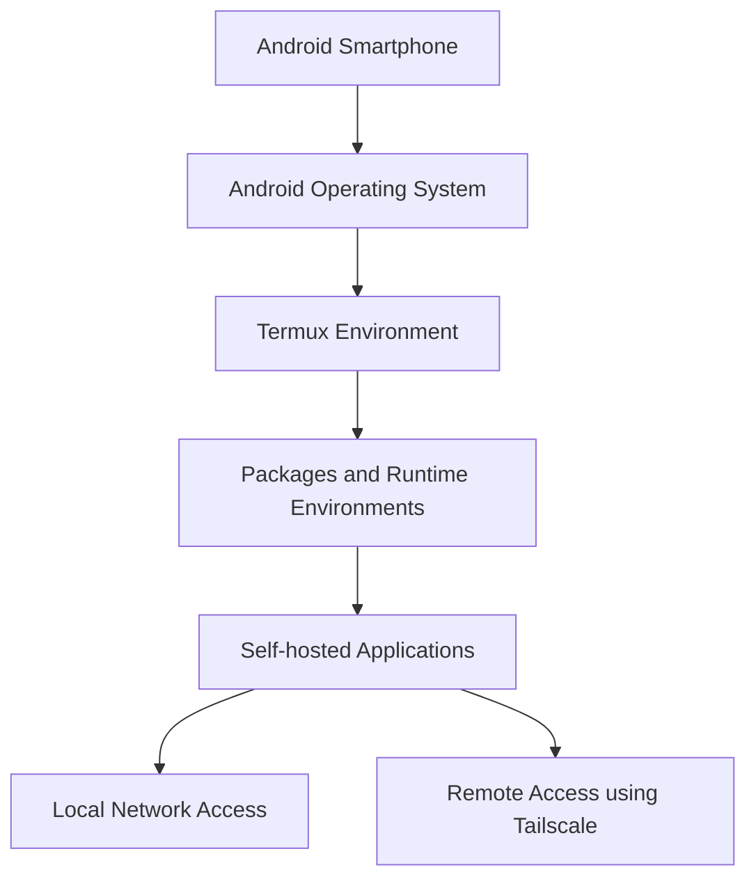

# Introduction to Android Homelabs

## 1. What Is a Homelab?

A homelab is a personal environment where people experiment with servers, networking, operating systems, applications and other technologies.

It provides an opportunity to learn practical IT skills without depending on expensive enterprise infrastructure.

A traditional homelab might contain:
- Old desktop computers or laptops
- Dedicated servers
- Raspberry Pi devices
- Network switches and routers
- Storage devices

However, dedicated hardware is not always necessary. An unused Android smartphone can also serve as an inexpensive platform for experimenting with lightweight server applications.

## 2. Why Use an Android Smartphone?

Many old smartphones still have useful hardware even after they are no longer suitable for everyday use.

They often contain:
- Multi-core processors
- Several gigabytes of RAM
- Internal storage
- Wi-Fi and mobile networking capabilities
- Rechargeable batteries

Instead of leaving an unused smartphone in a drawer, we can repurpose it as a small server.

This approach also provides an opportunity to learn how software, networking and hardware work together.

**Important:** Not every Android smartphone is suitable for every server application. Performance depends on the processor, available memory, storage, Android version and application requirements.

## 3. How Does an Android Homelab Work?

We use an application called Termux to access a command-line environment on Android.

Termux provides a Linux-like user-space environment where we can install packages, use command-line utilities and run compatible programs.

It does not replace Android with a conventional Linux operating system. Android continues to manage the device and its hardware.

The general architecture looks like this:

### Understanding the components

**Android Smartphone**

The physical device that provides the processor, RAM, storage and network connectivity.

**Android Operating System**

Manages the device, hardware, applications, permissions and background processes.

**Termux**

Provides a terminal and package-management environment where we can run compatible command-line programs.

**Packages and Runtime Environments**

Software components required by applications. For example, a Java-based application needs a compatible Java runtime.

**Self-hosted Applications**

The actual services we want to run. Examples include game servers, file servers and web servers.

**Network Access**

Allows other devices to communicate with the applications running on our Android smartphone.

## 4. What Can We Host?

An Android homelab can be used to experiment with different kinds of self-hosted services.

Some examples include:

| Application | What It Does |
|---|---|
| Minecraft Server | Allows players to connect to a multiplayer game server |
| File Server | Allows devices to access and transfer files over a network |
| Web Server | Hosts websites and web applications |
| Other Services | Provides opportunities to experiment with additional compatible applications |

The compatibility of each application must be checked before installation.

This project will document different applications as they are implemented and tested.

## 5. Local Access vs Remote Access

A server can be accessed in different ways.

### Local Network Access

Devices connected to the same local network can communicate using the server device's local IP address and the application's port.

For example, a laptop and an Android phone connected to the same Wi-Fi network can communicate directly over that network.

### Remote Access

Sometimes we want to access our server from another location.

Tools such as Tailscale can create a private network between devices, allowing authorized devices to communicate without directly exposing the server's service ports to the public internet.

Remote access and its configuration will be covered in a separate tutorial.

## 6. Limitations of Using Android as a Server

Although smartphones can run useful server applications, they have limitations.

**Background process management**

Android may restrict or terminate background applications to conserve resources.

**Battery optimization**

Battery-saving settings can interfere with long-running server processes.

**Thermal throttling**

Continuous processor usage can increase device temperature, potentially reducing performance.

**Hardware limitations**

Older processors, limited RAM and slow storage may restrict which applications can run comfortably.

**Storage limitations**

The internal storage available for applications, databases, files and backups may be limited.

**Application compatibility**

Some Linux applications require system features or architectures that may not be available in a Termux environment.

These limitations should be considered before choosing an Android device for a particular server application.

## 7. What Will We Build in This Project?

We will gradually turn the Android smartphone into a small experimental homelab.

The project will cover:

1. Preparing the Android device.
2. Installing and configuring Termux.
3. Learning essential Linux commands.
4. Understanding networking fundamentals.
5. Installing and configuring server applications.
6. Setting up remote access.
7. Applying basic security practices.
8. Automating server management.
9. Creating backups and restoring services.

Each application will have its own installation and configuration guide.

## 8. Conclusion

Repurposing an old Android smartphone as a homelab server is an inexpensive way to explore practical computing concepts.

Through this project, we aim to understand more than just how to install applications. We also want to learn the fundamentals of Linux environments, networking, server administration, security and automation.

The goal is to make these concepts accessible to beginners through practical, reproducible tutorials.
