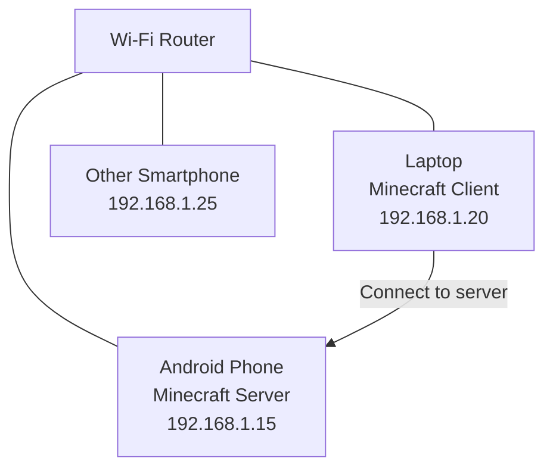
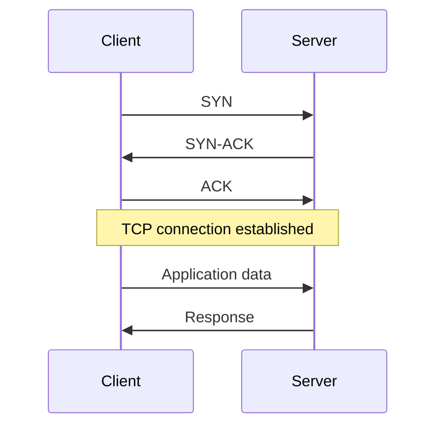
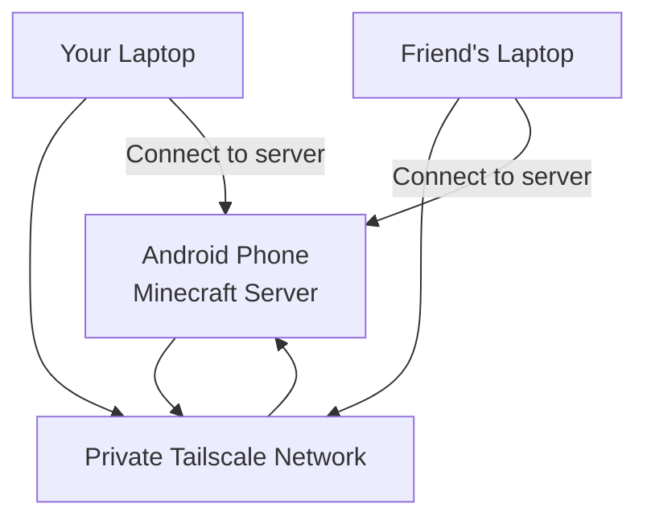

# Networking Fundamentals for an Android Homelab

## 1. Introduction

Networking is one of the most important concepts to understand when building a homelab.

A server is useful only when other devices can communicate with it.

For example, when we host a Minecraft server on an Android smartphone, a laptop or another smartphone needs to establish a network connection to that server.

To understand how this works, we need to learn some basic networking concepts:

- IP addresses
- Local Area Networks (LAN)
- Private and public IP addresses
- Subnet masks
- Default gateways
- DNS
- Network ports
- TCP and UDP
- NAT
- Remote access

This chapter introduces these concepts and explains how they apply to our Android homelab.

## 2. What Is a Computer Network?

A computer network is a group of connected devices that can communicate and exchange information.

Examples of network-connected devices include:

- Smartphones
- Laptops
- Desktop computers
- Servers
- Routers
- Network printers

When your Android smartphone and laptop connect to the same Wi-Fi router, they become part of the same local network, assuming the router permits communication between them.

### Example: Our Android Homelab

Imagine the following setup:

- An Android smartphone hosts a Minecraft server.
- A laptop runs the Minecraft game.
- Both devices connect to the same Wi-Fi router.

The laptop sends network traffic to the Android smartphone.

The smartphone receives that traffic and passes it to the Minecraft server application.

The server processes the request and sends a response back.

This allows the laptop to communicate with the hosted Minecraft server.

## 3. Understanding IP Addresses

An IP address is a numerical address used to identify a network interface and route information between devices using the Internet Protocol.

Think of an IP address as a delivery address: it helps network traffic reach the intended destination.

There are two commonly discussed IP versions:

- IPv4
- IPv6

### 3.1 IPv4 Addresses

IPv4 addresses consist of 32 bits, usually represented as four decimal numbers separated by dots.

For example:

```text
192.168.1.10
```

Each section is called an octet and can have a value from 0 to 255.

Other example addresses include:

```text
192.168.1.1
10.0.0.5
172.16.0.20
```

IPv4 is commonly used in home networks and many local server environments.

### 3.2 IPv6 Addresses

IPv6 was developed to provide a much larger address space than IPv4.

An IPv6 address contains 128 bits and is commonly written using hexadecimal notation separated by colons.

For example:

```text
2001:db8::1234
```

IPv6 is increasingly used in modern networks and internet connectivity.

Our initial Android homelab tutorials will primarily use IPv4 because it is sufficient for understanding our first server setup.

## 4. Private IP Addresses vs Public IP Addresses

IP addresses are commonly categorized as private or public when discussing IPv4 networking.

### 4.1 Private IP Addresses

Private IP addresses are used inside local networks, such as home, college or office networks.

They are not directly routable across the public internet.

The three standard private IPv4 ranges are:

| Private Range | Address Range |
|---|---|
| 10.0.0.0/8 | 10.0.0.0 – 10.255.255.255 |
| 172.16.0.0/12 | 172.16.0.0 – 172.31.255.255 |
| 192.168.0.0/16 | 192.168.0.0 – 192.168.255.255 |

For example:

```text
192.168.1.10
```

This could be the local IP address of an Android smartphone connected to a home Wi-Fi network.

Another device on the same network can use this address to communicate with it.

### 4.2 Public IP Addresses

A public IP address is an address that can be routed across the public internet.

Your internet connection may use a public IP address assigned by your Internet Service Provider (ISP).

Public IP addresses allow networks to communicate across the internet.

However, having a public IP address does not automatically make every device inside your local network accessible from the internet.

Routers, firewalls and network address translation can affect incoming connections.

### 4.3 How to Find Your Android Phone's Local IP Address

On Android:

1. Open Settings.
2. Go to Wi-Fi.
3. Open the details of the connected Wi-Fi network.
4. Look for the IP address.

The exact menu names depend on the Android manufacturer and version.

For example, your phone may display:

```text
192.168.1.15
```

This is an example address, not an address that every device will have.

**Important:** A local IP address may change when the phone reconnects to Wi-Fi or receives a new DHCP lease.

## 5. Understanding LAN (Local Area Network)

A Local Area Network, or LAN, connects devices within a limited geographical area.

Examples include:

- Home Wi-Fi networks.
- College computer laboratories.
- Office networks.
- Local Ethernet networks.

### Example

Suppose your home network contains these devices:

| Device | Example Local IP |
|---|---|
| Wi-Fi Router | 192.168.1.1 |
| Android Server | 192.168.1.15 |
| Laptop | 192.168.1.20 |
| Another Smartphone | 192.168.1.25 |

The devices can communicate using their local IP addresses if network configuration and security settings permit it.

### Network architecture



In this example, all devices are connected to the same router.

The laptop uses the Android phone's local IP address to reach the Minecraft server.

### Important: Same Wi-Fi does not always mean devices can communicate

Some routers provide guest Wi-Fi networks or client isolation.

These features may prevent wireless devices from communicating directly with one another.

If two devices are connected to the same Wi-Fi but cannot communicate, network isolation may be one possible cause.

## 6. Understanding Subnet Masks

A subnet mask helps determine which portion of an IPv4 address represents the network and which portion identifies a host within that network.

A commonly used subnet mask in home networks is:

```text
255.255.255.0
```

This is also written as:

```text
/24
```

For example:

```text
IP Address:   192.168.1.15
Subnet Mask:  255.255.255.0
```

With this configuration, the network is:

```text
192.168.1.0/24
```

The address `192.168.1.20` is in that same IPv4 subnet.

The subnet mask helps devices determine whether a destination is reachable directly on the local network or whether traffic should be sent through a router.

## 7. Understanding the Default Gateway

A default gateway is the network device that a computer uses to forward traffic when the destination is not on its directly connected network.

In a typical home network, the Wi-Fi router acts as the default gateway.

For example:

```text
Android IP:       192.168.1.15
Laptop IP:        192.168.1.20
Default Gateway:  192.168.1.1
```

When the laptop communicates with another device on its local subnet, it can generally send traffic directly through the local network.

When it communicates with an external internet destination, it sends the traffic to the default gateway.

The router then forwards it towards the destination, subject to its routing and security rules.

## 8. Understanding DHCP

DHCP stands for **Dynamic Host Configuration Protocol**.

It automatically provides network configuration to devices joining a network.

This configuration commonly includes:

- IP address
- Subnet mask
- Default gateway
- DNS server information

For example, when your Redmi phone connects to your home Wi-Fi, the router may automatically assign it an IP address.

Without DHCP, many networks would require manual network configuration for every device.

### Why DHCP matters for our homelab

Suppose the Android server initially receives:

```text
192.168.1.15
```

Later, the router may assign it:

```text
192.168.1.18
```

If the address changes, clients using the old IP address may no longer be able to reach the server.

For a more predictable local setup, a router may support DHCP reservation, which associates a device with a reserved address.

This is different from manually configuring a static IP address on the phone.

## 9. Understanding Network Ports

An IP address identifies the destination network interface, while a port helps identify the application or service receiving traffic on that device.

Think of the IP address as the building address and the port as the particular office inside that building.

Ports are numerical values ranging from 0 to 65535.

They are used by transport protocols such as TCP and UDP.

### Example

Suppose an Android smartphone has this local IP address:

```text
192.168.1.15
```

A Minecraft Java server normally listens on TCP port:

```text
25565
```

A client connects using:

```text
192.168.1.15:25565
```

The address tells the client which network destination to contact.

The port identifies the service it wants to reach.

### Common port examples

| Port | Common Service |
|---|---|
| 22 | SSH |
| 53 | DNS |
| 80 | HTTP |
| 443 | HTTPS |
| 25565 | Minecraft Java default server port |

These are common defaults, not guarantees that a service is running on that port.

The actual port depends on application configuration.

### Port ranges

The Internet Assigned Numbers Authority (IANA) divides port numbers into three ranges:

| Range | Name |
|---|---|
| 0–1023 | System Ports |
| 1024–49151 | User Ports |
| 49152–65535 | Dynamic and/or Private Ports |

Some applications have registered default ports, while others choose configurable ports.

## 10. Understanding TCP

TCP stands for **Transmission Control Protocol**.

It is a transport-layer protocol that provides reliable, ordered delivery of data between communicating applications.

TCP includes mechanisms for:

- Establishing a connection.
- Detecting lost data.
- Retransmitting missing data.
- Keeping data in order.
- Detecting connection problems.

### TCP Three-Way Handshake

Before normal TCP data exchange begins, the communicating endpoints establish a connection using a process called the three-way handshake.

It involves three steps:

1. SYN – The client requests a connection.
2. SYN-ACK – The server acknowledges the request.
3. ACK – The client acknowledges the server's response.

Diagram:



### TCP in our Android Homelab

Minecraft Java servers normally use TCP for player connections.

For example, a client connecting to:

```text
192.168.1.15:25565
```

must be able to establish a TCP connection to the server at that address and port.

If the connection cannot be established, the client may report a connection timeout or another connection error.

## 11. Understanding UDP

UDP stands for **User Datagram Protocol**.

Unlike TCP, UDP does not establish a connection through a three-way handshake before sending data.

UDP sends independent datagrams.

It does not provide TCP's built-in guarantees of reliable, ordered delivery.

Applications that use UDP may implement their own reliability mechanisms when needed.

UDP is often useful when low overhead or timely delivery is important.

Examples include:

- Real-time communication.
- Voice and video applications.
- Some multiplayer game networking.
- DNS queries in common configurations.

### TCP vs UDP

| Feature | TCP | UDP |
|---|---|---|
| Connection setup | Connection-oriented | Connectionless |
| Delivery guarantee | Reliable delivery mechanisms | No built-in delivery guarantee |
| Data ordering | Preserves byte-stream order | No built-in ordering guarantee |
| Retransmission | Supported | Not built in |
| Common uses | Web connections, Minecraft Java | DNS, real-time applications |

The protocol required by a service depends on the application.

Opening a TCP port does not automatically open the corresponding UDP port.

## 12. Understanding Localhost

Localhost refers to the device on which a program is running.

For IPv4, the commonly used loopback address is:

```text
127.0.0.1
```

For IPv6, the loopback address is:

```text
::1
```

When an application connects to localhost, it communicates with a service on the same device rather than reaching another computer through the network.

### Example

Suppose a web server is running on port 8080 of your Android phone.

You may be able to test it locally using:

```text
http://127.0.0.1:8080
```

This only works when the application is listening on an appropriate local interface and the service is available.

### What is 0.0.0.0?

The address:

```text
0.0.0.0
```

has a special meaning when used as a listening or binding address.

An application configured to listen on `0.0.0.0` for IPv4 generally accepts connections addressed to its available IPv4 interfaces, subject to firewall and network restrictions.

It is not the address that another device should normally type to reach your server.

Use the actual reachable IP address of the server instead.

**Security note:** Listening on all interfaces can make a service reachable from more networks. Only expose a service on the interfaces and networks that you intend to allow.

## 13. Understanding DNS

DNS stands for **Domain Name System**.

It translates human-readable domain names into IP addresses and can provide other types of DNS information.

For example, people commonly use:

```text
example.com
```

instead of remembering a numerical IP address.

When a device needs to resolve a domain name, it can query a configured DNS resolver.

The resolver helps find the corresponding DNS records.

### Why DNS matters

DNS makes network services easier to access.

Instead of remembering an IP address, users can enter a name.

Some private networking tools also provide DNS names for devices inside a private network.

This can make homelab services easier to remember and manage.

## 14. Understanding NAT

NAT stands for **Network Address Translation**.

It is a technique used by routers to translate network addresses between different networks.

A common example is a home router allowing several devices with private IPv4 addresses to share an internet connection through one public IPv4 address.

### Example

A home network may contain:

```text
Android Phone: 192.168.1.15
Laptop:        192.168.1.20
Tablet:        192.168.1.25
```

The router may translate their outgoing traffic so that it uses the same public IPv4 address.

When the router receives responses, it uses its connection-tracking information to forward traffic to the appropriate internal device.

This common arrangement is often called NAT with port translation.

### Why NAT matters for remote server hosting

When another person tries to connect from outside your home network, their traffic does not automatically know which device inside your home should receive it.

A router may require a port-forwarding rule to direct incoming traffic to a particular internal device.

However, direct port forwarding introduces security considerations and is not necessary for every remote-access solution.

Some internet providers also use Carrier-Grade NAT (CGNAT), which places customers behind additional shared address translation. This can prevent ordinary inbound port forwarding from working.

## 15. Local Network Access vs Remote Access

There are two common ways to access an Android homelab server.

### 15.1 Local Network Access

When a client and server are connected to the same local network, the client can use the server's local IP address.

Example:

```text
Server IP: 192.168.1.15
Port:      25565
```

The Minecraft client can enter:

```text
192.168.1.15:25565
```

This is appropriate for devices that can communicate directly over the same LAN.

### 15.2 Remote Access

Now imagine that your friend lives in another city.

Your friend cannot normally use your phone's private address:

```text
192.168.1.15
```

That address belongs to your local network and is not globally unique.

One solution is a private networking tool such as Tailscale.

Tailscale creates a private network between authorized devices using an encrypted connection based on WireGuard.

Devices connected to the same authorized network can communicate using their Tailscale addresses, subject to network access policies and connectivity.

For example:

```text
Android Server:
100.x.x.x

Friend's Laptop:
100.y.y.y
```

These are illustrative addresses, not actual device addresses.

The friend can use the Android device's Tailscale address together with the application's port.

For our Minecraft setup, the connection would look conceptually like:

```text
Tailscale-IP:25565
```

### Basic architecture



The devices must be authorized to communicate under the applicable sharing and access-control settings.

Tailscale does not mean that every service on the phone should automatically be accessible to everyone. Application-level security and network access policies remain important.

## 16. How Networking Works in Our Minecraft Server

Let's combine the concepts we've learned.

Our Android phone runs a PaperMC Minecraft Java server.

A player wants to connect from a laptop.

The following steps occur:

1. The player enters the server's IP address and port in the Minecraft client.
2. The client identifies the destination network address.
3. It attempts to establish a TCP connection to the configured port.
4. The Android device receives the connection request.
5. The operating system delivers the network traffic to the application listening on that port.
6. PaperMC processes the Minecraft connection.
7. The server responds with the necessary game data.

For a local connection, the client uses the phone's local IP address.

For a remote connection through Tailscale, the client uses the phone's Tailscale IP address.

The Minecraft server still listens on its configured service port.

**Important:** Network connectivity and Minecraft authentication are separate concepts. A device may be able to reach the server while the Minecraft login or server configuration still rejects the player.

## 17. Practical Exercise: Identify Your Network Information

Let's inspect the network configuration of the devices used in our homelab.

### Step 1: Find your Android phone's local IP address

1. Open Android Settings.
2. Open Wi-Fi.
3. Select the currently connected network.
4. Find the IP address field.

Record the following information:

```text
Device:
Local IP address:
Wi-Fi network:
```

Do not publish your real private network details unnecessarily.

### Step 2: Find your laptop's local IP address

On Windows, open Command Prompt and execute:

```cmd
ipconfig
```

Find the network adapter currently connected to your Wi-Fi.

Look for:

```text
IPv4 Address
Subnet Mask
Default Gateway
```

Example:

```text
IPv4 Address:    192.168.1.20
Subnet Mask:     255.255.255.0
Default Gateway: 192.168.1.1
```

These are example values.

### Step 3: Compare the two devices

Suppose your Android phone has:

```text
192.168.1.15
```

And your laptop has:

```text
192.168.1.20
```

With the example `/24` subnet configuration, both addresses belong to the same IPv4 subnet.

This means they can generally communicate directly, provided network settings allow it.

### Step 4: Understand the Minecraft port

Our Minecraft Java server normally uses TCP port:

```text
25565
```

Combining the Android phone's local address and port gives:

```text
192.168.1.15:25565
```

This is an example of the server address a local Minecraft client could use.

### Step 5: Test the connection from Windows

If the Minecraft server is running, open PowerShell on the laptop and execute:

```powershell
Test-NetConnection 192.168.1.15 -Port 25565
```

Replace the example IP with the actual Android phone's local IP address.

Look for:

```text
TcpTestSucceeded : True
```

A result of `True` indicates that the TCP connection test succeeded.

A result of `False` means the connection test failed. Possible causes include:

- The Minecraft server is not running.
- The IP address is incorrect.
- The application is not listening on the expected port.
- A firewall or network policy is blocking traffic.
- The devices are isolated from one another.

This test checks TCP connectivity. It does not prove that Minecraft authentication or gameplay will work.

## 18. Common Networking Problems

### Problem 1: Server works on the phone but not on another device

Possible causes:

- The application is listening only on the loopback interface.
- The wrong IP address is being used.
- The service is not listening on the expected port.
- A firewall or Wi-Fi isolation rule is blocking traffic.

Check the application's network configuration and test connectivity from the client device.

### Problem 2: Server works on the same Wi-Fi but not remotely

Possible causes:

- Tailscale is disconnected.
- The remote device has not been authorized.
- Access policies prevent the connection.
- The remote device is using the wrong Tailscale IP.
- The server is no longer running.
- A network connection is unavailable.

Check local connectivity first, then troubleshoot the remote-access layer.

### Problem 3: IP address changes

DHCP can assign a different local IP address when a device reconnects.

Consider using a DHCP reservation on the router if a predictable local IP address is needed.

### Problem 4: Connection timeout

A timeout generally means that the expected connection did not complete within the allowed period.

It can result from routing problems, network filtering, an unreachable device or an unavailable service.

Test the network connection separately from the application.

### Problem 5: Port is unreachable

Check that:

- The application is running.
- The application is listening on the expected protocol and port.
- The client is using the correct destination address.
- Network security settings permit the connection.

Remember that TCP and UDP are separate protocols.

## 19. Security Considerations

Networking makes server applications accessible to other devices, but accessibility also introduces security risks.

Follow these practices:

- Do not expose server ports to the public internet without understanding the risks.
- Prefer private remote-access solutions when appropriate.
- Restrict access to trusted devices and users.
- Use authentication and authorization features provided by applications.
- Keep server software updated.
- Avoid publishing private IP addresses, Tailscale addresses, credentials or configuration secrets.
- Understand the difference between network access and application authentication.

### Important: Minecraft Offline Mode

Some Minecraft servers are configured with:

```properties
online-mode=false
```

This disables normal Mojang/Microsoft account authentication by the server.

A whitelist in offline mode can restrict which usernames are allowed, but it does not provide reliable identity verification. Someone may be able to impersonate an allowed username.

This setting is therefore not suitable for treating a publicly reachable server as securely authenticated.

For an experimental server, restrict access to trusted participants and use a private network. Do not expose an offline-mode server publicly.

## 20. Conclusion

Networking is the foundation that allows devices to communicate with services hosted on our Android smartphone.

In this chapter, we learned:

- What computer networks are.
- How IPv4 and IPv6 addresses work.
- The difference between private and public IP addresses.
- How LANs connect devices.
- How subnet masks and gateways work.
- How DHCP assigns network information.
- How ports identify services.
- The differences between TCP and UDP.
- What localhost and DNS mean.
- How NAT affects internet connectivity.
- How local and remote server access work.
- How to test a Minecraft server connection.

Understanding these concepts will make it easier to configure, troubleshoot and secure the applications running in our Android homelab.

In the next chapter, we will learn how to configure remote access using Tailscale.

## 21. References

- [RFC 1918 – Address Allocation for Private Internets](https://www.rfc-editor.org/rfc/rfc1918)
- [RFC 9293 – Transmission Control Protocol (TCP)](https://www.rfc-editor.org/rfc/rfc9293)
- [RFC 768 – User Datagram Protocol (UDP)](https://www.rfc-editor.org/rfc/rfc768)
- [RFC 1034 – Domain Names: Concepts and Facilities](https://www.rfc-editor.org/rfc/rfc1034)
- [IANA – Service Name and Transport Protocol Port Number Registry](https://www.iana.org/assignments/service-names-port-numbers/service-names-port-numbers.xhtml)
- [Tailscale Documentation](https://tailscale.com/kb/)
