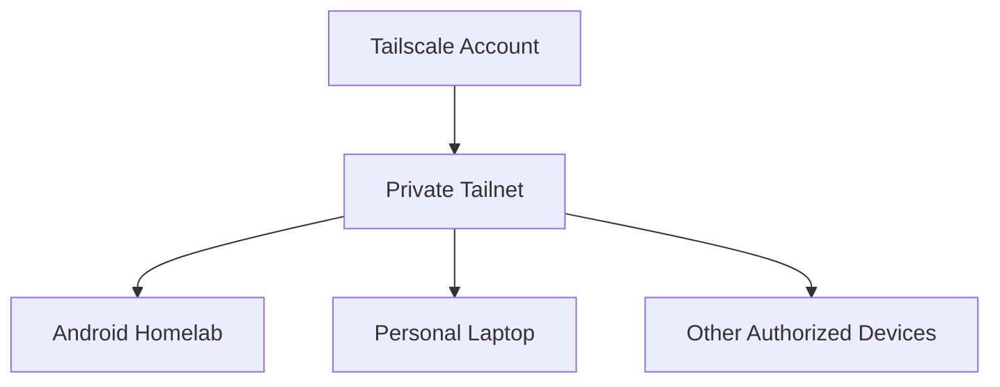
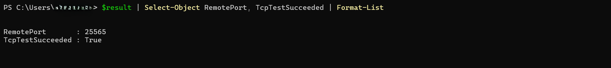
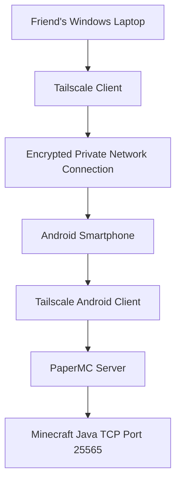

# Remote Access to an Android Homelab Using Tailscale

## 1. Introduction

When hosting a server on an Android smartphone, devices connected to the same local Wi-Fi network can usually access it using its local IP address.

However, what happens when we want to access the server from another location?

For example:

- A Minecraft server is running on an Android smartphone at home.
- A friend wants to connect from another city.
- The friend is connected to a completely different Wi-Fi network.

The private IP address of the Android smartphone is not normally reachable from the public internet.

One solution is to use a private networking tool such as Tailscale.

This tutorial explains how to configure Tailscale so that authorized devices can access applications hosted on an Android homelab.

## 2. What Is Tailscale?

Tailscale is a networking solution that connects devices through a private network called a tailnet.

It uses WireGuard-based encrypted connections to help devices communicate securely.

Instead of exposing a server's application port directly to the public internet, we can use Tailscale to connect authorized devices.

For example, imagine the following setup:

- An Android smartphone hosts a Minecraft server.
- A laptop is used to play Minecraft.
- A friend has another laptop in a different location.

By connecting these devices through Tailscale, the laptops can communicate with the Android server using its Tailscale IP address.

### Why use Tailscale for an Android Homelab?

Some advantages include:

- Private connectivity between authorized devices.
- Encrypted network communication.
- Access from different physical locations.
- No need to configure ordinary router port forwarding for a typical Tailscale connection.
- Support for Android, Windows and several other operating systems.
- Device sharing without giving external users access to your entire tailnet.

Official website:

[https://tailscale.com/](https://tailscale.com/)

## 3. Understanding a Tailnet

A tailnet is a private network created and managed through Tailscale.

Devices connected to the same tailnet can communicate according to the network's access-control policies.

For example:



Each connected device is assigned a Tailscale IP address.

Tailscale uses these addresses to identify devices inside the private network.

Tailscale addresses are different from the private IP addresses assigned by your Wi-Fi router.

For example:

| Address Type | Example |
|---|---|
| Local Wi-Fi IP | 192.168.1.15 |
| Tailscale IPv4 | 100.x.y.z |

The addresses shown above are examples, not real device addresses.

## 4. Requirements

Before configuring remote access, make sure you have:

- An Android smartphone running Android 8.0 or later.
- A Windows laptop or another supported client device.
- An internet connection on both devices.
- A Tailscale account.
- Administrative access to the tailnet from which the Android device will be shared.

The Android 8.0 requirement applies to the current Tailscale Android client documentation.

For this project, the initial setup uses:

| Device | Operating System |
|---|---|
| Android Homelab | Redmi Note 8 Pro, Android 11 |
| Personal Laptop | Windows 11 |
| Friends' Devices | Windows laptops |

Official installation instructions:

- [Tailscale for Android](https://tailscale.com/docs/install/android)
- [Tailscale for Windows](https://tailscale.com/docs/install/windows)

## 5. Installing Tailscale on Android

The first step is installing Tailscale on the Android device that hosts our applications.

### Step 1: Download Tailscale

1. Open the Google Play Store on your Android smartphone.
2. Search for Tailscale.
3. Verify that the publisher is Tailscale Inc.
4. Install the application.

You can also use the official download page:

[https://tailscale.com/download](https://tailscale.com/download)

### Step 2: Open the application

Launch Tailscale after installation.

Select the option to get started or sign in.

### Step 3: Sign in

Authenticate using one of the supported sign-in providers.

Use an account that you control and intend to manage for your homelab.

### Step 4: Approve the VPN connection

Android will ask for permission to establish a VPN connection.

Review the prompt and approve it.

Tailscale uses the Android VPN interface to establish its network connection.

### Step 5: Connect the device

Once the setup is complete, enable Tailscale from the application.

The Android smartphone should now appear in your Tailscale device list.

The device needs an active Tailscale connection whenever remote clients are expected to access its services.

## 6. Installing Tailscale on Windows

The next step is installing Tailscale on the laptop that will access the Android server.

### Step 1: Download the Windows installer

Open:

[https://tailscale.com/download](https://tailscale.com/download)

Select Windows and download the installer.

### Step 2: Install the application

1. Open the downloaded installer.
2. Follow the installation instructions.
3. Complete the setup.

After installation, a Tailscale icon should appear in the Windows system tray.

### Step 3: Sign in

Open Tailscale and select the login option.

Authenticate using your Tailscale account.

If this is your personal laptop, you can use the same account as the Android homelab.

If this is a friend's laptop, they should use their own Tailscale account.

### Step 4: Connect

Once authenticated, enable Tailscale.

The laptop should now appear in the appropriate device list.

## 7. Understanding Tailscale Device Sharing

There are different ways to provide other users with access to Tailscale devices.

For this project, we use **device sharing**.

Device sharing allows us to share a particular machine with someone outside our tailnet.

This is useful when friends need access to one server but should not receive general access to every device in our private network.

### Why use device sharing?

Imagine that your tailnet contains:

- Your Android homelab server.
- Your personal laptop.
- Other personal devices.

Your friend only needs to access the Android server.

Instead of adding the friend as a member of your entire tailnet, you can share the Android device with their account.

This provides a narrower form of access.

Official documentation:

[Sharing your machines with other users](https://tailscale.com/docs/features/sharing)

## 8. Sharing the Android Server with a Friend

This section explains how to share the Android device.

You must have the appropriate administrative permissions for the tailnet that owns the device.

### Step 1: Open the Tailscale Admin Console

On a browser, visit:

[https://login.tailscale.com/admin/machines](https://login.tailscale.com/admin/machines)

Sign in using the account associated with your Android homelab.

### Step 2: Find your Android device

Locate the Redmi smartphone in the device list.

Make sure you identify the correct device before sharing it.

### Step 3: Open the sharing menu

1. Find the Android device.
2. Open its three-dot menu.
3. Select Share.

### Step 4: Share through email

1. Open the share-by-email option.
2. Enter your friend's email address.
3. Send the invitation.

Tailscale will send an invitation to the recipient.

### Step 5: Friend accepts the invitation

Your friend should:

1. Open the invitation.
2. Review the device-sharing request.
3. Sign in using their own Tailscale account.
4. Accept the invitation.

After acceptance, the shared Android device should become available to that recipient through their Tailscale client.

**Important:** Sharing a device is different from adding somebody to your tailnet. Do not invite friends as members of your entire tailnet when they only need access to one shared server.

## 9. Understanding the Sharing Permissions

When a user accepts a device-sharing invitation, Tailscale provides the minimum information needed for the connection.

A shared device is quarantined by default.

This means:

- The shared Android device can receive incoming connections from the recipient's tailnet.
- The shared Android device cannot initiate connections into the recipient's tailnet by default.
- The recipient does not automatically receive access to the other devices in the owner's tailnet.

For our Minecraft setup, this is useful because the friend needs to initiate a connection from their laptop to the Android server.

The default sharing behaviour supports this direction of communication.

The sharing interface may show permission descriptions involving device information and connection permissions. Review these carefully before accepting an invitation.

For additional restrictions, Tailscale access-control policies can be used to limit what a recipient can reach on the shared machine.

**Important security consideration:** Device sharing provides access to the shared device, not automatically only to one Minecraft port. Other services listening on that phone may also be reachable if the applicable access policies permit them.

Avoid running sensitive services on the same device without understanding their access controls.

## 10. Finding the Android Device's Tailscale IP Address

After connecting Tailscale, we need the Android server's Tailscale IP address.

### Step 1

Open the Tailscale Android application.

### Step 2

Locate the device information or open the corresponding device details.

### Step 3

Find the Tailscale IPv4 address.

It will commonly look like:

```text
100.x.y.z
```

This is only an example.

You can also inspect the device in the Tailscale Admin Console.

### Important

Do not confuse the following addresses:

```text
192.168.1.15
```

This is an example local Wi-Fi IP address.

```text
100.x.y.z
```

This represents the format of a Tailscale IPv4 address.

For a remote connection through Tailscale, the client should use the Tailscale address rather than the Android phone's private Wi-Fi address.

Never publish your actual private network or Tailscale addresses in this public tutorial repository.

## 11. Connecting to a Minecraft Server Remotely

Now let's apply everything to our first Android homelab application.

Assume that PaperMC is running on the Android smartphone and listening on its default Minecraft Java TCP port.

The default port is:

```text
25565
```

### Step 1: Confirm the server is running

Open the Termux session containing the Minecraft server.

Verify that PaperMC has completed startup and is ready to accept connections.

### Step 2: Confirm Tailscale is connected

On the Android phone, open Tailscale.

Make sure its connection is active.

On the friend's Windows laptop, check that Tailscale is connected and the shared Android device is visible.

### Step 3: Obtain the Android Tailscale IP

Use the actual Tailscale IPv4 address of the Android phone.

For this tutorial, we will use a placeholder:

```text
100.x.y.z
```

### Step 4: Construct the Minecraft server address

Combine the Tailscale IP address with the Minecraft server port:

```text
100.x.y.z:25565
```

Replace the example IP with the actual device address.

### Step 5: Open Minecraft Java Edition

On the friend's laptop:

1. Open Minecraft Java Edition.
2. Select Multiplayer.
3. Select Add Server.
4. Enter a server name.
5. Enter the Tailscale IP and port.
6. Save the server entry.
7. Select Join Server.

The client should attempt to connect to the Android-hosted Minecraft server.

Whether the player can join also depends on the Minecraft version, server configuration and authentication settings.

## 12. Testing the Network Connection from Windows

Before troubleshooting Minecraft itself, we can test whether a TCP connection to the server port is possible.

Windows provides a PowerShell command called `Test-NetConnection`.

Open PowerShell and execute:

```powershell
Test-NetConnection YOUR_ANDROID_TAILSCALE_IP -Port 25565
```

Replace `YOUR_ANDROID_TAILSCALE_IP` with the actual Tailscale IP address.

For example, the command uses this structure:

```powershell
Test-NetConnection 100.x.y.z -Port 25565
```

The address must be replaced with a valid device address before executing the command.

### Understanding the output

Look for:

```text
TcpTestSucceeded : True
```

A value of `True` means the Windows laptop successfully established a TCP connection to the specified address and port.

A value of `False` means the test failed.

Possible causes include:

- The Minecraft server is not running.
- Tailscale is disconnected.
- The wrong Tailscale address was entered.
- Device sharing has not been accepted.
- An access-control policy blocks the connection.
- The application is not listening on the expected port.

This command tests TCP connectivity. It does not verify Minecraft authentication or prove that the player can successfully join the game.

### Actual Tailscale Connection Test

The following screenshot demonstrates a successful TCP connectivity test from a remote Windows device to the Android homelab server through Tailscale.



The `TcpTestSucceeded` result confirms that the remote device could establish a TCP connection to the Minecraft server port.

## 13. Understanding the Connection Flow

The complete architecture looks like this:



The laptop connects to the Android smartphone through Tailscale.

Tailscale provides the private network connection.

The Minecraft application receives the connection on its configured port.

This allows players at different physical locations to communicate with the server without requiring a normal public-facing Minecraft port-forwarding rule.

## 14. Troubleshooting Common Problems

### Problem 1: Shared Android device does not appear

Possible causes:

- The invitation has not been accepted.
- The wrong Tailscale account was used.
- The Android device is disconnected.
- The invitation was revoked or expired.

Check the device-sharing status in the Tailscale Admin Console.

### Problem 2: Shared device appears, but connection fails

Possible causes:

- The Android device is offline.
- Tailscale is not connected.
- The destination IP is incorrect.
- Access-control policies prevent the connection.
- The application is not listening on the requested port.

Check the network connection separately from the application.

### Problem 3: TCP test returns False

Start troubleshooting in this order:

1. Verify that PaperMC is running.
2. Verify that the Android phone's Tailscale connection is active.
3. Confirm that the friend has accepted the sharing invitation.
4. Confirm the Tailscale IP address.
5. Test the TCP connection again.
6. Review the sharing and access-control configuration.

Do not change unrelated Minecraft settings before identifying the actual cause.

### Problem 4: Minecraft reports a connection error

A Minecraft error may be caused by:

- Network connectivity problems.
- An incorrect server address.
- An incorrect server port.
- An incompatible game version.
- Server configuration.
- Authentication or whitelist settings.

First establish whether the underlying network connection works.

Then investigate Minecraft-specific problems.

### Problem 5: Connection works but drops unexpectedly

Possible causes include:

- Android background process restrictions.
- Internet interruptions.
- Tailscale disconnection.
- The Minecraft server process stopping.
- Device overheating.

Check both the server's runtime status and the Tailscale connection.

## 15. Stopping and Restarting Remote Access

Tailscale does not need to remain connected when the homelab server is not being used.

When finishing a session:

1. Stop the Minecraft server gracefully using the `stop` command in the PaperMC console.
2. Wait for the world to save and the server process to terminate.
3. Disconnect Tailscale on the Android phone if you no longer need remote access.
4. Friends can disconnect Tailscale from their own devices.

When starting the server again:

1. Connect Tailscale on the Android phone.
2. Connect Tailscale on the client devices.
3. Start the Minecraft server.
4. Wait for the server to finish loading.
5. Test the connection.

Remember that connecting Tailscale and starting PaperMC are two separate operations.

Tailscale provides network connectivity; it does not automatically start the Minecraft server.

## 16. Security Considerations

Remote access is useful, but it must be configured carefully.

Follow these practices:

- Only share your Android server with people you trust.
- Use individual Tailscale accounts for each friend.
- Do not publish Tailscale IP addresses, invitation links or account details.
- Revoke access when a person no longer needs it.
- Understand that device sharing can provide access to multiple services on the shared phone.
- Keep server software and client applications updated.
- Use application-level authentication wherever supported.
- Avoid exposing application ports directly to the public internet unnecessarily.

### Important: Minecraft Offline Mode

Our initial Minecraft setup used:

```properties
online-mode=false
```

This disables the server's normal Minecraft account authentication.

A whitelist in offline mode restricts usernames but does not reliably verify player identities. A person may impersonate an allowed username.

Tailscale protects network communication and controls access to the shared device, but it does not authenticate Minecraft player identities.

Therefore:

- Keep the server restricted to trusted participants.
- Do not publicly expose this experimental server.
- Do not treat a whitelist in offline mode as secure identity verification.
- Consider enabling normal online authentication when using appropriately authenticated Minecraft accounts.

## 17. Conclusion

Tailscale provides a practical way to access applications hosted on an Android homelab from different locations.

In this chapter, we learned:

1. What Tailscale and a tailnet are.
2. How to install Tailscale on Android.
3. How to install Tailscale on Windows.
4. How device sharing works.
5. How to share an Android server with another user.
6. How to find a device's Tailscale IP address.
7. How to connect to a Minecraft server remotely.
8. How to test TCP connectivity.
9. How to troubleshoot common remote-access problems.
10. How to disconnect and reconnect safely.

By combining Termux, server applications and Tailscale, an unused Android smartphone can become accessible as a private homelab server from other authorized devices.

In the next chapter, we will explore security practices for protecting the applications and information hosted in our Android homelab.

## 18. References

- [Official Tailscale Website](https://tailscale.com/)
- [Install Tailscale on Android](https://tailscale.com/docs/install/android)
- [Install Tailscale on Windows](https://tailscale.com/docs/install/windows)
- [Share Your Machines with Other Users](https://tailscale.com/docs/features/sharing)
- [Connect to Devices](https://tailscale.com/docs/how-to/connect-to-devices)
- [Inviting Users vs Sharing a Device](https://tailscale.com/docs/reference/inviting-vs-sharing)
