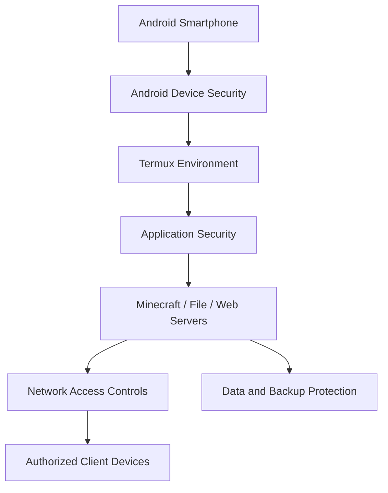

# Security Best Practices for an Android Homelab

## 1. Introduction

Security is an essential part of operating any server, including one hosted on an Android smartphone.

A homelab may contain applications, configuration files, personal data and network services that other devices can access.

If these services are configured incorrectly, unauthorized users may gain access to information, modify files or misuse the applications.

The goal of this chapter is to understand the different security risks associated with an Android homelab and learn how to reduce them.

We will cover:

- Android device security.
- Termux security and file permissions.
- Network access and remote connectivity.
- Application authentication.
- Minecraft server security.
- Credential and GitHub repository protection.
- Backup security.
- Basic incident response.

## 2. Understanding the Security Layers

An Android homelab has multiple components, and each one has different security requirements.

| Layer | What Needs Protection |
|---|---|
| Android device | Operating system, device access and permissions |
| Termux | Installed packages, scripts and files |
| Applications | Server software, configurations and user accounts |
| Network | Connections between clients and the server |
| Authentication | User identities and access permissions |
| Data | Files, databases and backups |
| Repository | Source code, documentation and credentials |

Security should be implemented across all these layers.

### Example architecture



A secure network connection alone does not guarantee that the application or its data is secure.

## 3. Securing the Android Device

The Android smartphone is the foundation of our homelab.

Anyone who gains unauthorized access to the device may potentially access its applications and data.

### 3.1 Use a Screen Lock

Enable a screen lock using a strong PIN or password.

Depending on the device, Android may also support fingerprint or facial authentication.

Avoid easily guessed PINs such as birthdays or repeated digits.

### 3.2 Keep Android Updated

Operating system updates may provide:

- Security fixes.
- Vulnerability patches.
- Stability improvements.
- Compatibility improvements.

Check the Android security update settings periodically.

Older smartphones may no longer receive security patches. If a device is no longer supported, understand that its operating system may contain unpatched vulnerabilities.

For this reason, avoid treating an unsupported phone as a suitable location for sensitive personal or business information.

The initial test device in this project is a Redmi Note 8 Pro running Android 11. Check its actual security patch level rather than assuming it is fully updated.

### 3.3 Review Application Permissions

Android applications operate with permissions that control access to certain device resources.

Examples include:

- Camera.
- Microphone.
- Location.
- Contacts.
- Files and shared storage.

Grant only the permissions that an application actually needs.

For example, Termux can request shared storage access through:

```bash
termux-setup-storage
```

This should be used when access to shared Android storage is required. It is not necessary for every server application.

### 3.4 Install Applications from Trusted Sources

Download applications from their official distribution sources.

For this project:

| Application | Trusted Source |
|---|---|
| Termux | [Official Termux GitHub](https://github.com/termux/termux-app) or [F-Droid](https://f-droid.org/packages/com.termux/) |
| Tailscale | [Official Tailscale download page](https://tailscale.com/download) |
| PaperMC | [Official PaperMC website](https://papermc.io/) |

Avoid downloading APK files or server software from unknown websites.

For Termux, install the main application and its optional add-ons from the same distribution source. Different sources can use different APK signing keys, which can cause installation and update problems.

## 4. Securing the Termux Environment

Termux provides a Linux-like user-space environment within Android.

A normal Termux installation operates under Android's application security model. It does not automatically provide unrestricted root access to the smartphone.

### 4.1 Avoid Unnecessary Root Access

Our initial homelab does not require rooting the Android smartphone.

Avoid obtaining additional privileges unless a specific, understood requirement makes them necessary.

Root access changes the device's security model and can increase the consequences of mistakes or compromised applications.

### 4.2 Keep Packages Updated

Termux packages may receive security fixes, bug fixes and compatibility updates.

Periodically execute:

```bash
pkg update
```

Then:

```bash
pkg upgrade
```

Review the package manager's prompts before confirming changes.

Only install packages from trusted repositories.

### 4.3 Install Only Required Packages

Avoid installing software without understanding its purpose.

Every additional package introduces more software that must be maintained and trusted.

For example, if a particular server requires Java and tmux, install those tools rather than adding unrelated packages.

A smaller installation is generally easier to maintain and troubleshoot.

### 4.4 Understand File Permissions

Linux-like environments use file permissions to control access to files and directories.

The three common permission types are:

| Permission | Meaning |
|---|---|
| Read (`r`) | Read file contents |
| Write (`w`) | Modify file contents |
| Execute (`x`) | Execute a file or traverse a directory |

Inspect permissions using:

```bash
ls -l
```

Example:

```text
-rw------- 1 u0_a123 u0_a123 1200 Nov 21 10:00 private.txt
```

Avoid making private files more accessible than necessary.

Do not use:

```bash
chmod 777
```

as a general solution to permission problems.

It grants broad permissions and can create unnecessary security risks.

## 5. Securing Network Access

A server becomes accessible to other devices through its network interfaces and listening ports.

Every exposed service may become a possible entry point.

### 5.1 Prefer Private Remote Access

For our Android homelab, we use Tailscale to establish private network connectivity.

Tailscale uses encrypted WireGuard-based connections and supports access-control policies.

This allows authorized devices to reach services without requiring ordinary public-facing port forwarding for a typical Tailscale connection.

Official documentation:

[https://tailscale.com/docs/](https://tailscale.com/docs/)

### 5.2 Share Access Only with Trusted Users

Only share the Android server with people who need access.

For example, if three friends need to play on the Minecraft server, they do not automatically need access to every other device or service in your personal network.

Review device-sharing permissions and access-control policies before granting access.

### 5.3 Understand Tailscale Access Controls

Tailscale provides two primary mechanisms for defining network access policies:

- **Grants:** The recommended modern approach for new access-control policies.
- **ACLs:** The older access-control mechanism, which remains supported.

Grants can specify which users or devices can connect to particular destinations and ports.

For example, a policy can restrict a device to a particular TCP port instead of permitting unrestricted network access.

This is useful when one Android smartphone hosts multiple applications.

Official documentation:

- [Tailscale Access Control](https://tailscale.com/docs/features/access-control)
- [Tailscale Grants](https://tailscale.com/docs/features/access-control/grants)

### 5.4 Avoid Unnecessary Public Port Forwarding

Port forwarding configures a router to direct incoming network traffic to a device inside a local network.

For example, forwarding Minecraft's default TCP port can make a Minecraft server reachable from the public internet.

However, it also allows external devices to attempt connections.

For this project, we prefer private remote access through Tailscale.

Do not enable public port forwarding unless you understand the application's authentication, security and network requirements.

### 5.5 Expose Only Necessary Services

If the Android phone hosts multiple applications, consider which devices should access each application.

For example:

| Service | Intended Access |
|---|---|
| Minecraft server | Authorized players |
| File server | Authorized file-sharing users |
| Web server | Intended website visitors |
| Administrative interface | Trusted administrators |

Administrative interfaces should not be exposed to untrusted networks.

Disable services and features that are not needed.

## 6. Authentication and Authorization

These two security concepts are related but different.

### Authentication

Authentication verifies the identity of a user or device.

For example, signing in with an account is an authentication process.

### Authorization

Authorization determines what an authenticated user is allowed to do.

For example, an ordinary user may be allowed to view files but not modify server configurations.

A secure homelab needs both.

A user successfully connecting to the network does not automatically mean they should have administrative privileges inside an application.

### Example

Consider a file server:

- Authentication verifies the user's identity.
- Authorization determines which directories that user can access.

The same principle applies to game servers, databases and web applications.

## 7. Securing the Minecraft Server

Minecraft is the first server application implemented in this project.

Its configuration provides several useful examples of application security.

### 7.1 Enable the Whitelist

The Minecraft whitelist restricts which player profiles are allowed to join the server.

In the PaperMC console, execute:

```text
whitelist on
```

To add a player:

```text
whitelist add PlayerName
```

To remove a player:

```text
whitelist remove PlayerName
```

To list permitted players:

```text
whitelist list
```

The whitelist is useful for limiting access to a private server.

However, its reliability as an identity control depends on the authentication configuration.

### 7.2 Understand Online Mode

The `server.properties` file contains the following setting:

```properties
online-mode=true
```

When enabled, a Minecraft Java server performs normal account authentication through Minecraft's authentication services.

This is the preferred configuration for servers using properly authenticated Minecraft accounts.

Our initial experimental server used:

```properties
online-mode=false
```

This disables the normal Minecraft account verification process.

When offline mode is enabled, a connecting player's identity is not reliably verified by the Minecraft authentication service.

The server can accept a username without establishing that the connecting person actually owns that account.

### Important: A Whitelist Does Not Fix Offline-Mode Authentication

In offline mode, Minecraft Java servers derive player UUIDs from usernames rather than verifying the authenticated account identity.

Consequently, someone may be able to impersonate an allowed username.

For this reason:

- Keep experimental offline-mode servers restricted to trusted participants.
- Do not publicly expose them.
- Do not treat a whitelist as secure identity verification.
- Avoid granting operator privileges unnecessarily.
- Prefer normal online authentication when using appropriately authenticated accounts.

Tailscale protects the network connection, but it does not authenticate Minecraft player identities.

### 7.3 Restrict Operator Privileges

Minecraft operators have additional administrative permissions.

Only grant operator privileges to people who genuinely need them.

To grant operator access:

```text
op PlayerName
```

To remove operator access:

```text
deop PlayerName
```

For a small private server, keep the number of operators limited.

### 7.4 Protect RCON
